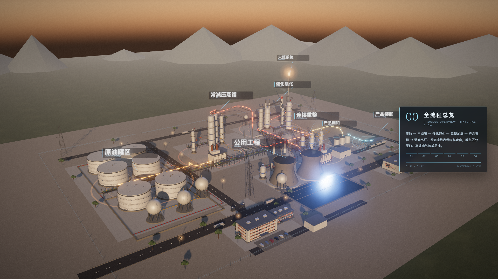

# 石油炼化厂 · 3D 场景与效果图

一个用 Three.js 程序化搭建的石油炼化厂三维场景：从原油储运、常减压蒸馏、催化裂化、连续重整到产品装卸的完整厂区，包含塔器、加热炉、换热器、储罐、球罐、冷却塔、管廊、火炬等典型炼化装置，并附带黄昏 / 白昼 / 夜景三套光照与 9 个机位的效果图。


## 效果图

| 文件 | 内容 | 光照 |
| --- | --- | --- |
| [`renders/aerial.png`](renders/aerial.png) | 全景鸟瞰 | 黄昏 |
| [`renders/hero.png`](renders/hero.png) | 主装置区（常减压 + 管廊） | 黄昏 |
| [`renders/cdu.png`](renders/cdu.png) | 常减压蒸馏装置特写 | 黄昏 |
| [`renders/fcc.png`](renders/fcc.png) | 催化裂化装置 + 火炬 | 黄昏 |
| [`renders/tanks.png`](renders/tanks.png) | 原油罐区 | 黄昏 |
| [`renders/night.png`](renders/night.png) | 厂区夜景（蓝调时刻） | 夜景 |
| [`renders/flow.png`](renders/flow.png) | 工艺流程示意（中文标注 + 流程条） | 黄昏 |
| [`renders/day.png`](renders/day.png) | 日景鸟瞰 | 白昼 |
| [`renders/top.png`](renders/top.png) | 总图俯视 | 白昼 |

## 场景构成

| 区域 | 主要构筑物 |
| --- | --- |
| 原油罐区 | 6 座浮顶储罐（直径 34 m）、3 座 LPG 球罐、防火堤、罐区管廊与泵组 |
| 常减压蒸馏 CDU/VDU | 常压塔（56 m）、减压塔、汽提塔、稳定塔、圆筒加热炉、换热器组、空冷器 |
| 催化裂化 FCC | 反应器、再生器（含旋风分离器）、主分馏塔、烟机烟囱、气压机、催化剂罐 |
| 连续重整 CCR | 3 台重整反应器、重整加热炉、压缩机房、换热器、循环管系 |
| 公用工程 | 2 座双曲线冷却塔、锅炉房与烟囱、水处理、变电所、输电塔 |
| 产品调和 | 3 座调和罐、调和泵组、成品油管线 |
| 产品装卸 | 装车鹤管、罐车、装卸管廊 |
| 火炬系统 | 74 m 高火炬、火焰与烟气 |
| 其他 | 全厂管廊、道路与标线、办公楼/中控室、仓库、围栏、路灯、绿化 |

## 交互式场景

场景需要以 HTTP 方式打开（ES Module 限制），仓库自带一个零依赖静态服务器：

```bash
cd refinery3d
node tools/serve.mjs . 4321
# 浏览器打开 http://127.0.0.1:4321/
```

- 鼠标拖拽旋转、滚轮缩放、右键平移
- 数字键 `1`–`9` 或底部按钮切换机位
- 点击设备查看参数，详见下节
- URL 参数：`?shot=night` 指定初始机位、`?clean=1` 隐藏界面（用于截图）

## 设备交互

场景中 35 台主要设备可点击：6 座原油储罐、3 座液化气球罐、常减压塔器/加热炉/换热器/空冷器、FCC 反应器/再生器/分馏塔/烟囱/主风机、重整反应器组/加热炉/压缩机房、冷却塔、锅炉房、火炬、调和罐组、装车棚、主管廊、办公楼与中控室。

- **悬停**：设备外框描边、鼠标变为手型，光标旁浮出中英文名称
- **点击**：左侧弹出设备信息卡，显示所属装置、中英文名、功能说明与 4 项关键参数；地面出现与所属装置配色一致的光环，设备外框高亮
- **⌖ 机位聚焦**：相机缓动飞向该设备（按包围盒自动取景，保证设备完整入画），并退出流程示意 / 动画演示，避免相机被其他模式接管
- **关闭**：`Esc`、关闭按钮或点击空白处；切换机位也会自动关闭

静态几何在 `bakeStatic` 时已按材质合并，无法逐部件 raycast，因此为每台设备建立不可见的包围盒代理（`src/interaction.js`），只对代理做射线检测并取最近命中；代理按距离排序，近处设备会自然遮挡远处设备。


| API | 说明 |
| --- | --- |
| `window.__equipReady` | 交互系统就绪 |
| `window.__equipList()` | 返回 35 台设备的 id、中英文名、坐标与尺寸 |
| `window.__selectEquip(id)` | 选中设备并打开信息卡（不移动相机） |
| `window.__focusEquip(id, immediate)` | 选中并聚焦；`immediate=true` 跳过缓动，便于可复现截图 |
| `window.__equipState()` | 当前选中 / 悬停 / 信息卡状态与相机位姿 |
| `window.__equipClose()` | 关闭信息卡 |

## 工艺流程动画

点击底部 **▶ 工艺流程动画**（或 `?shot=process`）进入动画演示：场景沿「原油 → 常减压 → 催化裂化 → 重整/加氢 → 产品调和 → 装卸出厂」自动播放，当前阶段的装置被地面光环、聚光与流线增亮高亮，HUD 同步显示阶段名、中英文说明与进度。



**物料流动**（`src/animation.js`，在 `bakeStatic` 之后创建，不会被合并）

| 流线 | 配色 | 路由 |
| --- | --- | --- |
| 原油 | 暗琥珀 `#ffa22e` | 罐区 → 泵组 → 主管廊 → 常减压加热炉 |
| 高温油气 | 橙红 `#ff4d1e` | 常压塔顶 → 管廊 → 催化裂化反应器 |
| 催化汽油 | 橙 `#ff7a2f` | FCC 分馏塔 → 管廊 → 重整加热炉 |
| 重整汽油 | 浅金 `#ffd27a` | 重整反应器 → 产品调和罐 |
| 成品油 | 青 `#7fe8ff` | 调和罐 → 装车鹤管 |
| 火炬排放 | 橙红 `#ff3a14` | FCC 再生器 → 火炬 |

每条流线由「发光管 + 流动虚线 shader + 沿线运动的粒子（THREE.Points）」组成，活跃阶段提高不透明度、粒子速度与尺寸，非活跃阶段自动变暗。

**工艺阶段**（每个阶段含场景坐标、机位、中英文名与说明）

| 阶段 | 装置 | 高亮方式 |
| --- | --- | --- |
| 01 原油储运 | 罐区 / 泵组 | 地面光环脉冲 + 暖色聚光 + 原油流线增亮 |
| 02 常减压蒸馏 | 常压塔 / 减压塔 / 加热炉 | 同上 + 塔顶油气流线 |
| 03 催化裂化 | 反应器 / 再生器 / 分馏塔 | 同上 + 催化汽油与火炬流线 |
| 04 重整 / 加氢 | 重整反应器 / 加热炉 | 同上 + 重整汽油流线 |
| 05 产品调和 | 调和罐区 / 调和泵 | 同上 + 成品油流线 |
| 06 装卸出厂 | 装车鹤管 / 罐车 | 同上 + 成品油流线 |

**环境动效**（常驻，任意机位可见）

- 火炬火焰抖动、发光强度闪烁与火炬烟气上升
- 冷却塔、锅炉房烟囱、FCC 烟囱的蒸汽 / 烟气上升飘散
- 空冷器风扇持续旋转（InstancedMesh，单 draw call）
- 烟囱航空障碍灯闪烁
- 罐车沿厂区道路行驶（3 辆，双向）
- 装车鹤管轻微摆动、阀门手轮与泵联轴器轻微转动

### 操作方式

| 操作 | 说明 |
| --- | --- |
| 空格 | 播放 / 暂停（冻结整个动画时钟，便于截图） |
| ← / → | 上一阶段 / 下一阶段 |
| T | 开关自动巡游（相机在阶段机位间缓动过渡） |
| 底部按钮 | 上一段 / 播放暂停 / 下一段 / 速度 0.5×·1×·2× / 自动巡游 |
| 点击阶段序号 | 直接跳转到对应阶段 |
| 鼠标拖拽 | 暂停自动巡游（不影响动画播放） |
| 数字键 1–9 | 仍为原有 9 个机位；选择普通机位会退出动画演示 |

### 动画 API（用于截图与集成）

| API | 说明 |
| --- | --- |
| `window.__animReady` | 动画系统构建完成（与 `__ready` 同时置位） |
| `window.__setStage(i)` | 跳到第 i 个阶段（0–5），机位立即到位 |
| `window.__setAnimTime(t)` | 设置动画时钟（秒），画面完全由该时刻决定 |
| `window.__pauseAnim()` / `window.__playAnim()` | 暂停 / 继续 |
| `window.__setAnimSpeed(x)` | 速度 0.5 / 1 / 2 |
| `window.__setCruise(b)` | 自动巡游开关 |
| `window.__animOverview()` | 全流程总览（显示装置标注 + 全部流线 + HUD） |
| `window.__animState()` | 返回当前阶段、时间、播放状态、各流线不透明度 |
| `window.__flowInfo()` | 返回 6 条流线的配色与折线坐标 |
| `window.__project(x,y,z)` | 世界坐标 → 屏幕像素（自检用） |

动画使用显式时间（火焰抖动、粒子位置、罐车位置等全部由 `t` 计算，不含 `Math.random`），因此 `__pauseAnim()` + `__setAnimTime(t)` 可复现任意一帧。

### 动画截图

| 文件 | 内容 |
| --- | --- |
| [`renders/anim-01.png`](renders/anim-01.png) | 01 原油储运（罐区机位） |
| [`renders/anim-02.png`](renders/anim-02.png) | 02 常减压蒸馏 |
| [`renders/anim-03.png`](renders/anim-03.png) | 03 催化裂化 |
| [`renders/anim-04.png`](renders/anim-04.png) | 04 重整 / 加氢 |
| [`renders/anim-05.png`](renders/anim-05.png) | 05 产品调和 |
| [`renders/anim-06.png`](renders/anim-06.png) | 06 装卸出厂 |
| [`renders/anim-overview.png`](renders/anim-overview.png) | 全流程总览（中文装置标注 + HUD） |

```bash
node tools/anim.mjs          # 生成 7 张动画截图并自检（非全黑 / mean 20–180 / clip < 3%）
node tools/anim.mjs check    # 只做自检，输出 ASCII 缩略与统计，不写入 renders/
```

在 `?clean=1` 截图模式下，`?clean=1&anim=1&stage=N&t=T` 仍会显示阶段讲解 HUD（隐藏控制按钮），便于生成带讲解的定格画面。

## 重新生成效果图

```bash
cd refinery3d
node tools/final.mjs            # 渲染全部机位到 renders/
node tools/final.mjs night flow # 只渲染指定机位
```

脚本使用本机 Chrome 无头模式 + Puppeteer 截图，尺寸 1920×1080。

## 技术说明

- Three.js r160，全部几何与贴图程序化生成，无外部模型/图片素材
- 自定义天空 shader（渐变、太阳、云、星空）、ACES 色调映射、UnrealBloom、暗角与颗粒
- 大量重复细节（栏杆、梯子、法兰、管段）在构建后合并为少量 draw call
- 设备拾取使用 bake 之后创建的不可见包围盒代理，不破坏静态合并；交互高亮（光环 / 线框）同样在合并后创建
- 工艺流程动画在合并之后创建：流线用自定义 shader 的发光管 + Points 粒子，环境动效以实例化网格与精灵实现，动画全部由显式时间驱动，固定时间可复现
- 场景按真实炼厂尺度建模，单位：米

> 说明：本场景为示意性艺术化模型，装置布局、管线走向经过简化与美化，不作为工程设计依据。