# 石油炼化厂 · 3D 场景与效果图

一个用 Three.js 程序化搭建的石油炼化厂三维场景：从原油储运、常减压蒸馏、催化裂化、连续重整到产品装卸的完整厂区，包含塔器、加热炉、换热器、储罐、球罐、冷却塔、管廊、火炬等典型炼化装置，并附带黄昏 / 白昼 / 夜景三套光照与 9 个机位的效果图。


## 效果图

| 文件 | 内容 | 光照 |
| --- | --- | --- |
| [`renders/aerial.png`](renders/aerial.png) | 全景鸟瞰 | 黄昏 |
| [`renders/hero.png`](renders/hero.png) | 主装置区（常减压 + 管廊） | 黄昏 |
| [`renders/cdu.png`](renders/cdu.png) | 常减压蒸馏装置特写 | 黄昏 |
| [`renders/fcc.png`](renders/fcc.png) | 催化裂化装置 + 火炬 | 黄昏 |
| [`renders/tanks.png`](renders/tanks.png) | 原油罐区 | 黄昏 |
| [`renders/night.png`](renders/night.png) | 厂区夜景（蓝调时刻） | 夜景 |
| [`renders/flow.png`](renders/flow.png) | 工艺流程示意（中文标注 + 流程条） | 黄昏 |
| [`renders/day.png`](renders/day.png) | 日景鸟瞰 | 白昼 |
| [`renders/top.png`](renders/top.png) | 总图俯视 | 白昼 |

## 场景构成

| 区域 | 主要构筑物 |
| --- | --- |
| 原油罐区 | 6 座浮顶储罐（直径 34 m）、3 座 LPG 球罐、防火堤、罐区管廊与泵组 |
| 常减压蒸馏 CDU/VDU | 常压塔（56 m）、减压塔、汽提塔、稳定塔、圆筒加热炉、换热器组、空冷器 |
| 催化裂化 FCC | 反应器、再生器（含旋风分离器）、主分馏塔、烟机烟囱、气压机、催化剂罐 |
| 连续重整 CCR | 3 台重整反应器、重整加热炉、压缩机房、换热器、循环管系 |
| 公用工程 | 2 座双曲线冷却塔、锅炉房与烟囱、水处理、变电所、输电塔 |
| 产品调和 | 3 座调和罐、调和泵组、成品油管线 |
| 产品装卸 | 装车鹤管、罐车、装卸管廊 |
| 火炬系统 | 74 m 高火炬、火焰与烟气 |
| 其他 | 全厂管廊、道路与标线、办公楼/中控室、仓库、围栏、路灯、绿化 |

## 交互式场景

场景需要以 HTTP 方式打开（ES Module 限制），仓库自带一个零依赖静态服务器：

```bash
cd refinery3d
node tools/serve.mjs . 4321
# 浏览器打开 http://127.0.0.1:4321/
```

- 鼠标拖拽旋转、滚轮缩放、右键平移
- 数字键 `1`–`9` 或底部按钮切换机位
- 点击设备查看参数，详见下节
- **设备清单**（右侧）：35 台设备按罐区 / 常减压 / 催化裂化 / 重整 / 公用工程 / 调和 / 装卸分组，支持中文名、英文名、位号（如 `T-101`）搜索；回车聚焦第一项
- **小地图**（右下）：厂区俯视轮廓、相机位置与朝向、当前选中设备高亮，20 Hz 刷新
- **导览**（右下「导览」按钮）：6 段自动讲解 + 中英字幕，可播放 / 暂停 / 上一段 / 下一段，可开语音朗读（默认关闭）
- **分享链接**（「分享链接」按钮）：把机位、相机位姿、画质档、选中设备、动画阶段与时间编码进 URL，复制后打开即还原
- URL 参数见下节表格

## URL 参数

| 参数 | 取值 | 说明 |
| --- | --- | --- |
| `shot` | `aerial` / `hero` / `cdu` / `tanks` / `fcc` / `night` / `flow` / `day` / `top` / `process` | 初始机位；`process` 直接进入工艺流程动画 |
| `q` | `high` / `mid` / `low` | 强制画质档（同时关闭自动降档） |
| `clean` | `1` | 隐藏全部 HUD（截图用）；设备清单 / 小地图 / 分享 / 导览一并隐藏 |
| `stats` | `1` | 显示性能面板（等价于按 `P`） |
| `autoq` | `0` | 关闭「连续 5 s FPS < 35 自动降一档」 |
| `procedural` | `1` | 跳过烘焙快照，改为实时程序化建模（约慢 14 s，用于对比 / 兜底） |
| `prebaked` | `0` | 同上（等价写法） |
| `prep` | `compile` / `compileasync` | 首帧前显式 `renderer.compile` / `compileAsync`（冷启动实验用） |
| `anim` | `1` | 直接进入工艺流程动画；配合 `stage` / `t` / `playing` / `cruise` |
| `stage` | `0`–`5` | 动画起始阶段 |
| `playing` | `0` / `1` | 动画是否自动播放（默认播放） |
| `cruise` | `1` | 进入后开启相机自动巡游 |
| `t` | 秒 | 动画起始时间 |
| `labels` | `1` | 强制显示流程标签（`?anim=1` 时） |
| `dof` | `1` / `0` | 强制开启 / 关闭景深 |
| `autoexposure` | `0` | 关闭自动曝光（锁定在预设曝光） |
| `prebaked` | `1` / `0` | 默认开启烘焙快照；`0` 等同 `procedural=1` |
| `profile` | `1` | 包装 `gl.linkProgram` / `compileShader` 做启动诊断 |
| `weather` | `clear` / `rain` / `snow` / `fog` | B 批天气；默认 `clear`（与现有截图一致） |
| `audio` | `1` / `0` | D2 环境音：`1` 首次手势后自动开启，`0` 强制关闭（默认静音） |
| `sw` | `0` | E1：不注册 Service Worker（默认注册） |
| `xray` | `1` | E4：启动即开启透视 |
| `params` | `0` | E3：隐藏工艺参数面板 |
| `normal` | `1` | 开启 B 批法线贴图（默认关闭：1440p 下填充率开销 -33%，超出预算） |
| `motion` | `0` | 关闭 B 批动态细节（旗帜 / 鸟群 / 蒸汽随风），用于像素对比 |
| `st` | base64url | 分享链接状态（机位 / 相机位姿 / 画质 / 选中设备 / 动画阶段与时间），见「分享链接」 |

> `?st=` 与上述参数兼容：机位、画质由链接里的值覆盖，其余参数（`clean`、`procedural`、`stats`…）保持不变。

## 画质与性能（A 批优化）

场景提供三档画质，默认按设备能力自动选择；也可用 URL 参数强制指定。

| 档位 | Pixel Ratio 上限 | 阴影贴图 | Bloom | SSAO | 接触阴影 | FXAA | 景深 | 夜间点光 |
| --- | --- | --- | --- | --- | --- | --- | --- | --- |
| **high** | 2.0 | 2048² | 开 | 开 | 开 | 开 | 机位截图 / 巡游 | 12 |
| **mid** | 1.5 | 1024² | 开 | 关 | 开 | 开 | 关 | 6 |
| **low** | 1.2 | 512² | 关 | 关 | 关 | 关 | 关 | 2 |

自动选择规则：`hardwareConcurrency <= 4` 或 `devicePixelRatio > 2` → low；触屏 / 窄屏（< 1024 或高 < 720）→ mid；其余桌面 → high。右下角「画质 HIGH」小按钮可在三档间循环，`clean=1` 截图模式自动隐藏。

### 性能数据（本机无头 Chrome + ANGLE Metal，1920×1080）

| 指标 | 数值 |
| --- | --- |
| high 交互 FPS（景深关闭） | ≈ 33.4（1920×1080） |
| high 截图 FPS（景深开启） | ≈ 28.3（景深开销 15.3%） |
| high 交互 FPS（1280×720） | 60（vsync 上限） |
| low 交互 FPS（1280×720） | 60（vsync 上限） |
| high draw calls / triangles | 244 / ≈ 1.05 M（预烘焙路径；`__perf()` 的 calls 会累加 composer 各 pass） |
| 冷启动到 `__ready`（预烘焙，high） | ≈ 28.4 s（A6b，3 次中位 28.1–29.2；A 批 ≈ 44 s） |
| 冷启动到 `__fullReady`（完整画质） | ≈ 41 s（`__ready` 后约 12 s 补齐） |
| 同 profile 二次加载（warm → `__ready`） | ≈ 27.8 s（本机无磁盘 program 缓存，与冷启动接近） |
| 冷启动到 `__ready`（`?procedural=1`，high） | ≈ 42.8 s（A6b；A 批 ≈ 62 s） |
| 预烘焙相对实时代码构建的冷启动降幅 | ≈ 27–29% |

> 测试环境为无头软件渲染（`--enable-unsafe-swiftshader --use-angle=metal`），实际带独立 GPU 的桌面浏览器会明显更快；1280×720 下 high/low 都可能被 60 Hz vsync 截顶，因此低档收益主要体现在 1920×1080 与移动端高 DPR 场景。首帧主要受 40+ 材质变体的 GPU shader 编译限制。

### A 批对比截图

| 文件 | 内容 |
| --- | --- |
| [`renders/opt/a1-aerial.png`](renders/opt/a1-aerial.png) | A1：PMREM 环境光照 · 鸟瞰 |
| [`renders/opt/a1-hero.png`](renders/opt/a1-hero.png) | A1：主装置区 |
| [`renders/opt/a2-low.png`](renders/opt/a2-low.png) | A2：low 档，1280×720 |
| [`renders/opt/a3-cdu.png`](renders/opt/a3-cdu.png) | A3：SSAO + 接触阴影 · 常减压特写 |
| [`renders/opt/a4-shadow.png`](renders/opt/a4-shadow.png) | A4：阴影相机收紧（AO 关闭以隔离阴影） |
| [`renders/opt/a5-cinematic.png`](renders/opt/a5-cinematic.png) | A5：景深 + 色差 / 暗角 / 颗粒 |
| [`renders/opt/a6-prebaked.png`](renders/opt/a6-prebaked.png) | A6：默认预烘焙路径冷启动 |

统计（均值 / 暗部占比 / 过曝占比 / 帧耗时）见 [`renders/opt/stats.json`](renders/opt/stats.json)。

### 程序化 API

**状态 / 就绪**

| API | 说明 |
| --- | --- |
| `window.__ready` / `__readyAt` | 轻量首帧可交互；就绪时的 `performance.now()` |
| `window.__fullReady` / `__fullReadyAt` | 完整画质（装饰 + PMREM + postFX + 完整档位）就绪；时间为对应时刻 |
| `window.__upgradeFull()` | 手动触发完整画质升级（幂等） |
| `window.__animReady` / `__equipReady` / `__prebaked` | 动画 / 交互 / 烘焙快照路径是否就绪 |

**画质 / 后处理**

| API | 说明 |
| --- | --- |
| `window.__quality` | 当前档位（`high` / `mid` / `low`） |
| `window.__setQuality(q)` | 切档并重建 render target 尺寸，返回当前档位 |
| `window.__qualityInfo()` | 各档位参数表 + 当前档 |
| `window.__setDof(on)` | 强制景深开关 |
| `window.__setAO(on)` | SSAO 开关 |
| `window.__setContactShadows(on)` | 接触阴影开关 |
| `window.__setBloom(on)` | Bloom 开关 |
| `window.__setFXAA(on)` | FXAA 开关 |
| `window.__setCinematic(on)` | 电影感后处理开关 |
| `window.__setExposure(v)` | 固定曝光（关闭自适应） |
| `window.__setAutoExposure(on)` | 开关自动曝光（`false` 时钉住预设曝光，像素对比用） |
| `window.__shadowInfo()` | 阴影相机尺寸、贴图大小与焦点 |
| `window.__setStats(on)` / `window.__perf()` | 性能面板；`{fps, calls, triangles, quality, pixelRatio, ao, dof, fxaa, bloom, exposure}` |

**相机 / 机位**

| API | 说明 |
| --- | --- |
| `window.__shots` | 机位名数组（`['aerial', 'hero', …]`，共 9 个） |
| `window.__setShot(name)` | 切机位（`process` = 工艺流程动画），返回 `{shot, labels, quality}` |
| `window.__setCam({pos, target, fov})` | 直接设置相机位姿 |
| `window.__project([x,y,z])` | 世界坐标 → 屏幕像素（用于校验构图） |
| `window.__probe()` | 关键设备投影点位（回归测试用） |

**设备 / 交互**

| API | 说明 |
| --- | --- |
| `window.__equipList()` | 35 台设备清单 `{id, cn, en, unit, kind, x, y, z, w, h, d}` |
| `window.__focusEquip(id, immediate?)` | 选中设备并聚焦机位（设备清单点击走同一入口） |
| `window.__selectEquip(id)` | 只选中不移动相机 |
| `window.__equipState()` | `{selected, hover, card, tween, camera, target}` |
| `window.__equipClose()` | 关闭设备卡片 / 取消选中 |
| `window.__explorerState()` | 设备清单状态：`{items, groups, query, visible, selected, visibleRows, minimap}` |
| `window.__explorerSearch(q)` | 以代码驱动搜索框，返回命中条数 |

**工艺流程动画**

| API | 说明 |
| --- | --- |
| `window.__setStage(i)` | 跳到第 i 阶段（0–5） |
| `window.__setAnimTime(t)` | 设置动画时间（秒），返回新时间 |
| `window.__playAnim()` / `__pauseAnim()` | 播放 / 暂停 |
| `window.__setAnimSpeed(x)` / `__setCruise(b)` | 倍速 / 自动巡游 |
| `window.__animOverview()` | 全流程总览机位 |
| `window.__animState()` | `{active, overview, playing, cruise, speed, stage, stageElapsed, time, streams}` |
| `window.__flowInfo()` / `__labelProbe()` | 流线状态 / 标签屏幕位置（回归测试用） |

**导览 / 分享（C 批）**

| API | 说明 |
| --- | --- |
| `window.__tourStart(i)` | 开始导览（可指定起始段） |
| `window.__tourStop()` | 结束导览 |
| `window.__tourGoto(i)` | 跳到第 i 段 |
| `window.__tourState()` | `{active, index, stage, playing, voice, elapsed, total, subtitle}` |
| `window.__tourActive` | 导览是否进行中（与工艺流程动画互斥） |
| `window.__shareState()` | 当前状态的分享快照对象 |
| `window.__shareUrl()` | 生成分享链接（含 `?st=`），长度约 180–220 字符 |
| `window.__shareCopy()` | 复制到剪贴板，返回 `{url, len}` |
| `window.__applyShare(stateOrRaw)` / `__shareRestore()` | 应用分享状态 / 从当前 URL 的 `?st=` 恢复 |

**天气与动态细节（B 批）**

| API | 说明 |
| --- | --- |
| `window.__setWeather(name)` | 切换天气 `clear` / `rain` / `snow` / `fog`，同步调整粒子、湿滑材质、雾与天空 |
| `window.__weatherState()` | `{name, time, visible}` |
| `window.__weatherName` | 当前天气名（字符串，脚本用） |
| `window.__setWeatherTime(t)` | 把天气粒子时钟钉在 t 秒（冻结推进；`-1` 之后可 `__resumeTime()` 恢复） |
| `window.__motionState()` | `{time, flags, birds, steam}` 动态细节统计 |
| `window.__resumeTime()` | 恢复天气 / 动效时钟推进 |

**导出 / 透视 / PWA（E 批）**

| API | 说明 |
| --- | --- |
| `__exportPNG()` | 导出当前画面为 PNG（默认 3840×2160），返回 `{dataUrl,width,height,ms}` |
| `__recordTour()` | 录制 WebM（默认 30 s / 30 fps），返回 `{blob,bytes,mime,duration}` |
| `__setXray()` / `__xrayState()` | 透视开关 / `{on,spots}` |
| `__qrState()` / `__processState()` | 二维码状态 / 参数面板状态 |
| `__cacheState` / `__swState` | 快照缓存来源与耗时 / Service Worker 注册状态 |

**环境音（D2）**

| API | 说明 |
| --- | --- |
| `window.__audioState()` | `{on, want, ctx, volume, steamBursts, armed}`（`ctx` 为 `none`/`running`/`suspended`） |
| `window.__setAudio(on)` | 开关环境音（淡入/淡出 + 挂起），返回当前开关状态 |

**诊断（A6b）**

| API | 说明 |
| --- | --- |
| `window.__renderInfo()` | 程序数 / 按材质分组 / render 统计 / 显存 / GPU 与 `KHR_parallel_shader_compile` |
| `window.__timing()` | 冷启动分段 `perf.mark` 列表（含 GL 链路耗时汇总） |
| `window.__uiCost()` / `__uiCostReset()` | C 批 UI（清单 + 小地图 + 导览）每帧耗时统计 |
| `window.__bench(n)` | 同步渲染 n 帧，返回 `msPerFrame` / `fps`（绕过 vsync） |
| `window.__benchDirect(n)` | 不走 composer 的直接渲染基准 |
| `window.__benchReal()` | 真实（含 composer）帧耗时 |
| `window.__benchViews()` | 视图 / 相机创建基准 |
| `window.__compileProbe(mode)` | program 生成探测（`compile` / `compileAsync`） |
| `window.__progBench(n)` | 单 program 生成耗时基准 |
| `window.__pmremBench()` | PMREM 环境图生成基准 |
| `window.__snapProfile()` | 烘焙快照重建分段耗时 |
| `window.__renderOnce()` / `__debug` / `__occlude` | 手动重绘 / 调试句柄 / 遮挡探测 |
| `window.__scene` / `__camera` / `__renderer` / `__composer` / `__materials` / `__clay` / `__spot` | 场景对象句柄（控制台调试用，不保证跨版本稳定） |
| `window.__buildSnapshot` / `__snapshotBuffer` / `__snapshotChunk` | 烘焙快照构建的内部入口（预烘焙工具用） |

### A 批改动

- **A1 环境光照**：用天空 shader 通过 `PMREMGenerator.fromScene()` 生成 PMREM 环境图，dusk/day/night 三套缓存；金属、玻璃、水面使用更高 `envMapIntensity`，混凝土、沥青、植被保持低位；重新标定曝光，避免场景发灰/过曝。
- **A2 画质分档**：high/mid/low 三档控制 pixel ratio、阴影贴图、Bloom、SSAO、接触阴影、FXAA、景深、夜间点光数量；新增 HUD 切换按钮、性能面板、`?q` / `?stats` / `?autoq` 参数；连续 5 s FPS < 35 自动降一档。
- **A3 AO / 接触阴影**：vendor 未附带 GTAO/SSAO/SMAA，故自行实现基于 RenderPass 深度纹理的 SSAO（10 taps、保守强度）；为罐区、塔器、建筑、冷却塔、装车棚等设备底部加入合并为单 draw call 的程序化接触阴影（`bakeStatic` 之后加入，避免合并）。
- **A4 阴影 / 抗锯齿**：阴影相机按机位焦距收紧（近景 cdu 焦区约 ±95 m，2048² 贴图下约 0.09 m/texel），相机拖拽时节流重算；新增 FXAA pass，high/mid 开启，low 关闭。
- **A5 电影感后处理**：色差、柔暗角、细颗粒、±8% 缓慢曝光自适应；景深只在机位截图 / 巡游时开启，拖拽或流程标签时自动关闭，`?dof=1` 可强制。
- **A6 冷启动**：`tools/build-baked.mjs` 在构建期导出 `bakeStatic` 后的 41 个合并 Mesh（position/normal/uv/index + 材质名）到 `assets/baked.bin`（20.5 MB）/ `assets/baked.json`；运行时默认先 fetch 快照并直接 `BufferGeometry.setAttribute` 重建，跳过 units/plant 构建与 bake；几何元数据内联在 `src/bakedMeta.js`，只下载 20.5 MB 二进制。标签、夜间光晕、蒸汽、火炬火焰、控制室玻璃由 `createPlantDecor()` 补充；`?procedural=1` 可回退。

### A6b 冷启动优化

**测量工具**（新增，先量化再改代码）

\`\`\`bash
node tools/profile-startup.mjs --runs 3          # 冷启动 ×3（各自独立 profile）
node tools/profile-startup.mjs --warm 1          # 同一 profile 连续两次（第二次为 warm）
node tools/profile-startup.mjs --query "?shot=hero" --prep compile   # 指定机位 / 预热方式
\`\`\`

页面内 \`src/prof.js\` 用 \`performance.mark\` 打点（\`window.__t0\` 起算），并包装 \`gl.linkProgram\`、\`gl.compileShader\`、\`gl.bufferData\`、\`gl.drawElements\` 统计真实 GL 链路耗时；结果写入 \`diag/profile-startup.json\`，同时提供 \`window.__renderInfo()\` / \`window.__timing()\` 两个运行时诊断 API。

**实测结论：着色器编译不是瓶颈**（headless Chrome + ANGLE Metal，M1，1920×1080）

| 项 | 实测 |
| --- | --- |
| \`gl.linkProgram\` × 40 个程序 | 9.8 ms |
| \`gl.compileShader\` × 80 个 shader | 7.5 ms |
| 21.1 MB 顶点/索引上传（478 次 \`bufferData\`） | 25 ms |
| 1688 次 draw call 的 GL 调用本身 | 19 ms |

开销集中在 JS 侧的一次性成本：每个 program 的装配 + uniform/attrib 反射 + V8 首次 JIT（首个 ≈1.4 s，之后 20–90 ms）、PMREM \`fromScene\` 3.1–4.4 s、\`bakeStatic\` 2–5 s、首帧渲染路径首次执行 ≈6 s、\`createAnimation\` ≈7 s。所以优化方向是**减少首帧之前必须完成的工作**，而不是微优化 draw / shader。

**首帧渐进升级（staged boot）**

1. 轻量首帧：DPR 1、阴影只保留 define 不渲染贴图（\`shadowMap.autoUpdate = false\`）、无 postFX、无 PMREM 环境图、无标签/蒸汽/夜间光晕、轻量地面（草地 + 砾石两个平面）；
2. \`__ready\` 置位后用 \`requestAnimationFrame\`×2 触发 \`upgradeToFull()\`：装饰 → 完整地面 + 远山 → 接触阴影 → PMREM 环境图 → 完整档位（DPR / 阴影贴图 / composer）→ \`applyLook\` → render → \`__fullReady\`；
3. 所有截图/回归工具改为等待 \`window.__fullReady\`，保证出图仍是完整画质。

**其它改动**

- **材质程序合并**：\`constrainPrograms()\` 给每个 \`MeshStandardMaterial\` 补 1×1 白/黑 \`map\` / \`emissiveMap\`（\`MeshBasicMaterial\` 同理），消除「同材质、不同贴图组合」导致的重复 program，首帧程序数 40 → 6；
- **快照 gzip**：\`assets/baked.bin\` 20.53 MB → \`assets/baked.bin.gz\` 2.92 MB（-85.8%，3057022 B），运行时用 \`DecompressionStream('gzip')\` 解压，浏览器不支持或 404 时回退明文；打包脚本 \`tools/pack-baked.mjs\`；
- **下载提前**：快照 fetch 在建场之前发起，与天空/灯光/轻量地面创建并行；
- **取消运行时 merge**：地面与混合罐组不再调用 \`bakeStatic\`——本环境 draw call 极便宜（19 ms / 1688 draw），合并 60 个网格反而要 2–3 s；合并只保留在构建期（\`build-baked\`）。

**数据**（同机同法，预烘焙路径）

| 指标 | A 批 | A6b | 变化 |
| --- | --- | --- | --- |
| 冷启动 → \`__ready\` | 43.9–45.7 s | 28.1 / 28.4 / 29.2 s（中位 **28.4 s**） | **-35.5%** |
| 冷启动 → \`__fullReady\` | — | 40.8 / 41.1 / 42.2 s（中位 41.1 s） | 首帧后 +12.7 s 补齐 |
| 同 profile 二次加载 → \`__ready\` | — | 27.8 s | 与冷启动基本一致 |
| 轻量首帧 program 数 | 40 | 6 | -85% |
| \`assets/baked.bin\` 传输量 | 20.53 MB | 2.92 MB（gzip） | -85.8% |

冷启动分段（3 次中位，页面内 \`perf.mark\`）：

| 阶段 | 耗时 |
| --- | --- |
| 模块解析 + 渲染器 + 材质初始化 | 3.2 s |
| 快照下载（2.92 MB gzip） | 1.7 s |
| 快照重建 42 个 geometry | 2.2 s |
| \`createAnimation\`（含物流管线/罐车/风机） | 7.0 s |
| 交互系统 + 机位 | 1.2 s |
| 首帧 program 生成（\`renderer.compile\`） | 4.5 s |
| 首帧 \`render\` | 6.0 s |
| 首帧提交 / present | 1.2 s |

**为什么还没到 ≤15 s（剩余瓶颈）**

本机（无头 + ANGLE Metal + 低效 JIT）的固定成本：单个 program 冷装配 0.8–1.4 s、首帧渲染路径首次执行 ≈6 s、\`createAnimation\` 7 s、快照重建首个 item 固定 ≈1.4 s。这些与画质档位无关，单纯删画面也换不回来。

已试并放弃的方案（收益 <5% 或负收益）：

| 方案 | 结果 | 结论 |
| --- | --- | --- |
| \`compileAsync\` 并行链接（\`?prep=compileasync\`） | 链接本身仅 9.8 ms，并行只省 ~10 ms | 无收益 |
| probe 场景预热（1 cube × 全材质 + 64×64 RT） | 预热自身 8.0 s，只抵消后续 4.4 s | 净亏 3.6 s |
| 关闭 \`antialias\` | 首帧 render 6.1 s 不变（最终画面走 composer 的 4×MSAA RT） | 无收益 |
| 运行时 \`bakeStatic(ground / blendGroup)\` | 合并 60 网格 2–3 s，多出的 draw 只值 <1 ms | 移除 |

下一步可行方向（未实施，风险已在表中标注）：把 \`createAnimation\` 整体推迟到 \`upgradeToFull\`（约 -7 s；需给 HUD/流程交互加 stub，风险高）；首帧只画天空+地面占位（可进 15 s，但首帧内容不完整，属于画质回退，不做）；geometry 量化/减面（改动面大、影响视觉）。

**首帧 → 完整画质的已知限制**

\`__ready\` 到 \`__fullReady\` 之间（本机约 12 s）画面缺少：环境反射（金属偏暗偏灰）、阴影、SSAO/DOF/Bloom/FXAA、标签与蒸汽、完整地坪与远山。所有截图与验收都在 \`__fullReady\` 之后采集，逐机位对比见下节。

### A6b 对比截图

| 文件 | 内容 | 均值（vs A 批） |
| --- | --- | --- |
| [\`renders/opt2/a6b-aerial.png\`](renders/opt2/a6b-aerial.png) | 鸟瞰 | 115.1（115.6，-0.5） |
| [\`renders/opt2/a6b-hero.png\`](renders/opt2/a6b-hero.png) | 主装置区 | 121.1（123.1，-2.0） |
| [\`renders/opt2/a6b-cdu.png\`](renders/opt2/a6b-cdu.png) | 常减压特写（SSAO + 接触阴影） | 113.2（113.0，+0.2） |
| [\`renders/opt2/a6b-low.png\`](renders/opt2/a6b-low.png) | low 档 1920×1080 | 115.5 |

均值 / 暗部占比 / 过曝占比 / 性能 / 冷启动分段见 [\`renders/opt2/stats.json\`](renders/opt2/stats.json)；\`node tools/opt2-shots.mjs\` 可重新生成（同时校验与 A 批的均值偏差 ≤ ±5、clip < 1%）。

### C 批改动（交互与交付）

不改变画面观感与 17 张截图的构图：所有新 UI 都在 `?clean=1` 下隐藏，机位 / 曝光 / 后处理参数未动。

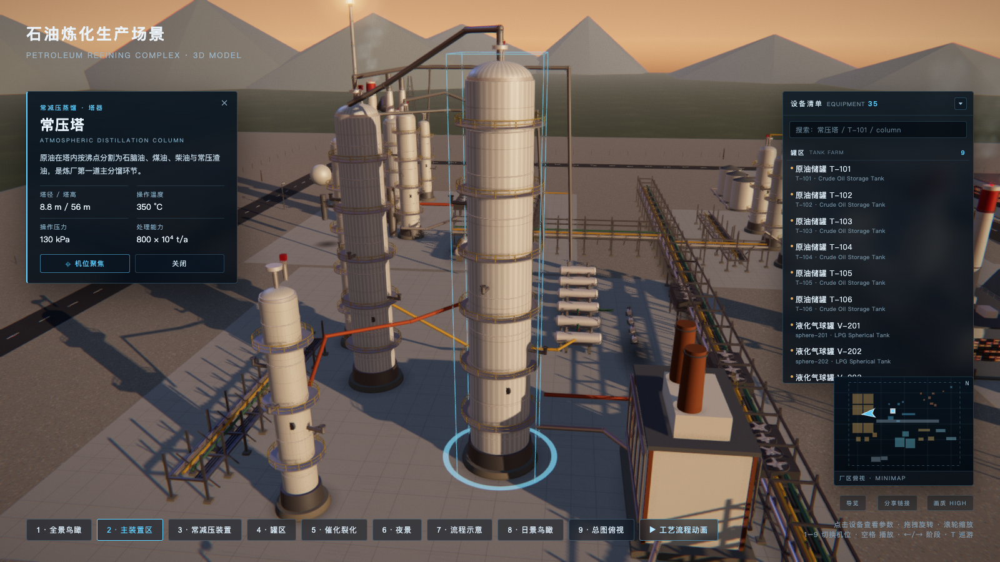
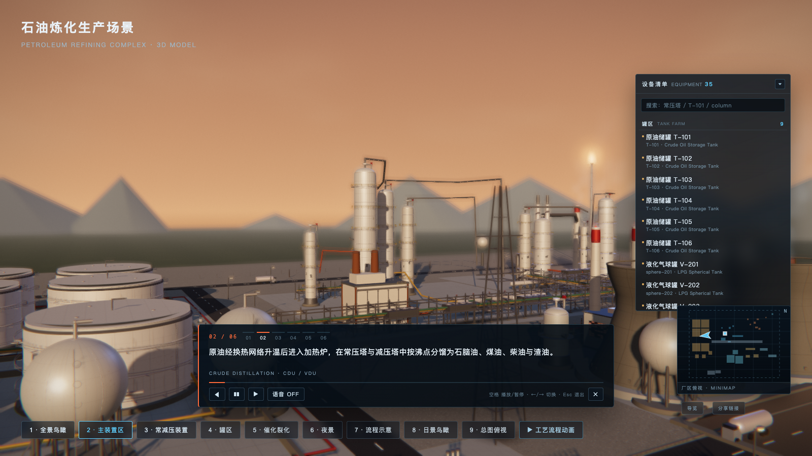
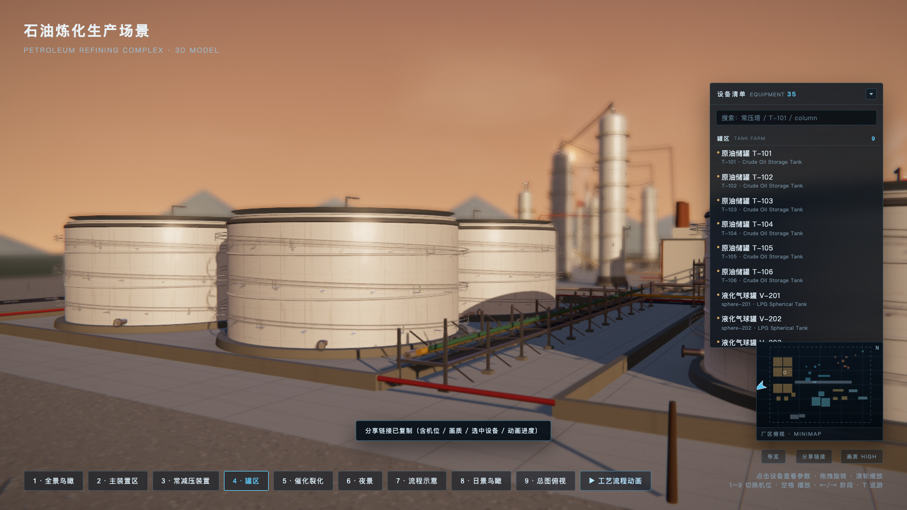

实测开销（1440×900、本机无头 Chrome，`__uiCost()`）：设备清单 + 小地图 0.11–0.27 ms/帧（占帧时 < 1.3%），导览稳定后 0.02 ms/帧（0.1%）；交叉 A/B 三次的帧时中位数在开关 UI 之间无可测差异（16.4/16.6/19.7 ms vs 16.7/20.9/20.1 ms）。重渲染的 aerial / hero / low / cdu 亮度均值与 A6b 基线分别差 0.00 / 0.00 / 0.00 / +0.10（clip 0%），即画面未变。

- **C1 设备清单 + 搜索 + 小地图**（[`src/explorer.js`](src/explorer.js)）：右侧可折叠面板，35 台设备按 8 个单元分组（罐区 / 常减压 / 催化裂化 / 重整 / 公用工程 / 调和 / 装卸 / 总图），支持中文名、英文名、位号（`T-101`、`cdu-`）与单元名搜索；点击走 `__focusEquip` 同一入口，因此面板选中与 3D 选中 / 卡片联动。右下角 canvas 2D 小地图画厂区轮廓、设备 footprint、相机位置与朝向箭头、选中设备高亮，20 Hz 刷新（端到端延迟 < 100 ms）。`≤900 px` 默认折叠成 130 px 小条，展开后不与 `#bar` / `#hint` 重叠；`#animui` / `#flowui` 打开时自动隐藏。
- **C2 分享链接**（[`src/share.js`](src/share.js)）：`snapshot()` 序列化 `{机位, 相机位姿, fov, 画质档, 选中设备, 动画阶段+时间}` → JSON → base64url，写进 `?st=`（实测 177–202 字符，< 2 KB）。「分享链接」按钮复制到剪贴板（失败回退 `execCommand` / `prompt`）。打开链接时在 `__fullReady` 之后落地，避免被 PMREM / 分档覆盖；链接里带画质档时会钉住该档、不再被自动降档改掉。
- **C3 导览模式**（[`src/tour.js`](src/tour.js)）：复用工艺流程 6 个阶段与 `STAGES[i].cam`，逐段 1.8 s 推镜 + 13 s 停留，底部字幕条同步中英文讲解与进度条；播放 / 暂停 / 上一段 / 下一段 / 段点点击 / Esc 退出；可选 `speechSynthesis` 中文朗读（默认关闭，按钮切换）。进入导览会 `anim.exit()` 并关掉巡游，切任意机位或进入工艺流程动画会自动退出导览（双向互斥）。
- **C4 一键冒烟 + CI**：[`tools/check-all.mjs`](tools/check-all.mjs) 依次跑 截图抽检（3 张）/ 动画校验 / 设备拾取 / opt2 画质对比，输出 `diag/check-all.json` 与 `diag/check-all.txt`，任一步失败非零退出；[`.github/workflows/ci.yml`](.github/workflows/ci.yml) 在 ubuntu + setup-chrome 上跑轻量版（anim check + 1 张截图）并上传 artifacts。Chrome 路径与 ANGLE 参数统一由 [`tools/chrome.mjs`](tools/chrome.mjs) 提供（`CHROME_PATH` 可覆盖，Linux 不传 `--use-angle=metal`）。
- **C5 部署与文档**：本文件补齐 URL 参数表、API 表、静态部署与目录结构；仓库根目录加 `.nojekyll`，可直接作为 GitHub Pages / 任意静态站点的子目录发布。
- **C6 代码结构（未做）**：`src/animation.js` 拆分（`data/stages.js` / `flow.js` / `tour.js` / `hud.js`）与 `data/layout.json` 抽离本轮未实施——收益只是可维护性，改动面覆盖 1000+ 行且要重跑全部像素回归，按「时间不够可只做数据抽离、不强行拆文件」的约定留到下一批。

### B 批改动（细节与氛围）

不改变工艺流程数据与设备坐标；17 张既有截图的机位与构图未动。9 张效果图亮度均值与 C 批基线相比：aerial +0.1 / hero +1.6 / cdu +0.6 / tanks +2.3 / fcc +0.1 / flow +3.5 / day -1.4 / top -0.2（均 ≤±4，clip ≤0.07%）；night 按 B4 目标单独由 73.6 提升到 91.8。

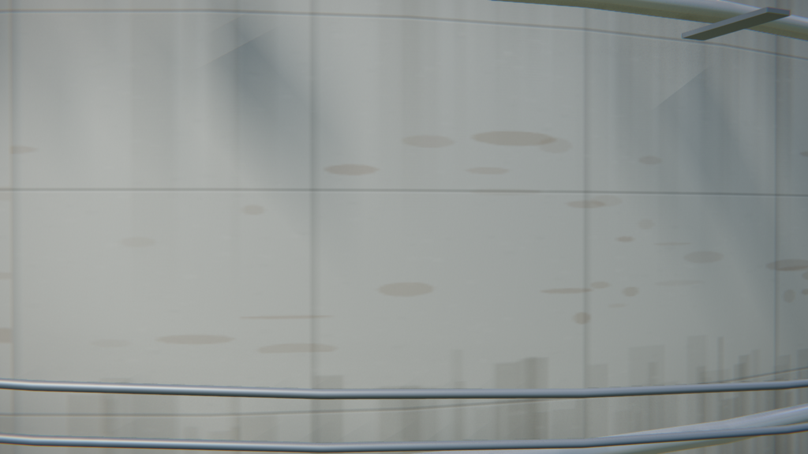
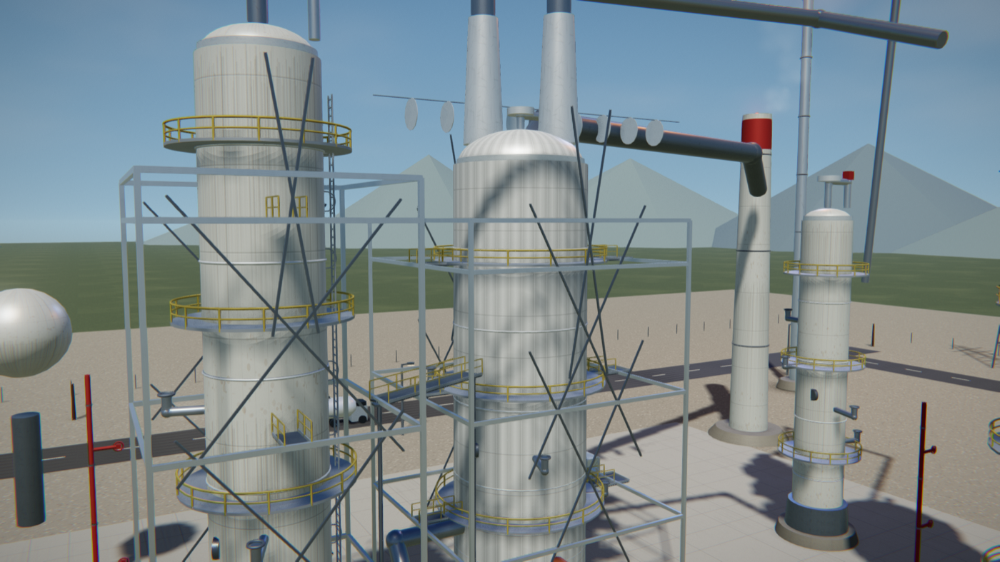
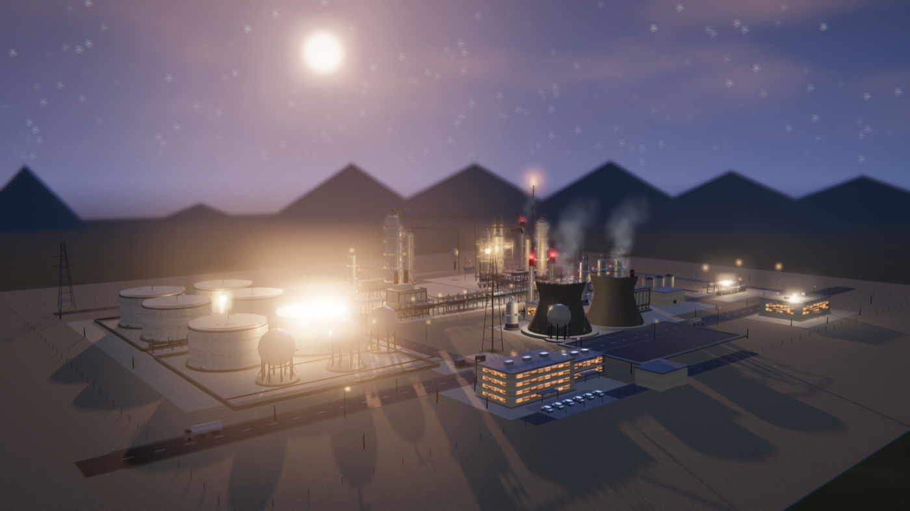

- **B1 材质升级**（[`src/textures.js`](src/textures.js)、[`src/materials.js`](src/materials.js)）：新增 5 张程序化贴图——粗糙度（竖向雨痕 + 斑块）、法线（噪声高度场求导）、污渍（乘到 `map` 上的淡痕）、罐体雨痕（`shellWeatheredTexture`，替换原罐体壳板）、沥青油污（油斑 / 裂缝 / 修补块）。金属度与粗糙度按类别分档：钢构 0.78/0.38、钢构（深）0.75/0.44、管道 0.84–0.88/0.30–0.36、保温 0.32–0.35/0.50–0.64、罐体 0.32/0.46–0.50、混凝土 0/0.80–0.90、沥青 0.05/0.90。所有 PBR 材质统一补 `roughnessMap` / `normalMap` 占位，保持单一 shader 变体（draw calls 与 C 批一致）；`m.__applyWet(on)` 提供湿滑变体（粗糙度 ×0.42、金属度 +0.16、`envMapIntensity` ×1.7、颜色 ×0.82，可逆），供 B3 天气复用。
- **B2 装置细节**（[`src/details.js`](src/details.js)）：FCC 再生器 17×17 四层钢构框架 + 3 层连接走道 + 落地楼梯、反应器 12×12 框架 + 层间走道、反应器↔再生器 20 m 空中走道、鼓风机房 / 主分馏塔电缆桥架、2 处消防立管、2 组阀门组、催化剂立管与烟道的保温捆扎带；重整三塔之间 7/15/22 m 三层走道（按塔半径断开，避免穿模）+ 端头楼梯 + 桥架 + 立管 + 阀门组；常减压塔区楼梯与检修平台、换热器区桥架与阀门组、2 处消防立管、塔顶蒸汽线捆扎带。全部复用既有材质，烘焙后不新增 draw call：新增三角面 **+63 k**（1,045,837 → 1,109,189），`assets/baked.bin` 21.6 → 22.3 MB（gz 2.90 → 3.13 MB），快照 meshes 42 → 41。
- **B4 夜间灯光**（[`src/plant.js`](src/plant.js)、[`src/environment.js`](src/environment.js)）：新增 20 余处作业灯 / 高杆灯 / 平台灯 glow（FCC 框架四角、重整走道、常压塔楼梯、装车区高杆灯、减压塔顶），夜间环境光 0.24（+50%）、半球光 0.72（+20%）、曝光 1.32→1.42、Bloom 0.8→0.9、阈值 0.78→0.74，灯罩自发光 3.4→4.4；另加 2 盏夜间点光源。night 亮度均值 **73.6 → 91.8**（目标 88–105），clip 0.21%，dark 0%。
- **B3 天气与时间**（[`src/weather.js`](src/weather.js)）：`?weather=rain|snow|fog` 与 `__setWeather(name)`；雨 1800 / 雪 1200 个粒子（显式时钟驱动，低画质档关闭），雨滴在 4 处有顶棚区域按高度裁剪不穿透；雨天/雪天/雾天分别调整太阳强度、雾密度、天空与星点，并开启湿滑材质。实测 clear → rain → clear 往返亮度差 **0.5**；rain / snow / fog 均值 74.6 / 91.5 / 76.5，clip 0%，无 console error。
- **B5 动态细节**（[`src/motion.js`](src/motion.js)）：蒸汽/烟羽随风向缓慢变化（风向 0.22 rad 摆幅、风速 ±35%）、3 面旗帜顶点级摆动、9 只远处鸟群；全部由显式时钟驱动并与 `__setAnimTime(t)` 同步（`__setWeatherTime(t)` 冻结粒子时钟）。冻结时钟后两次同机位截图 **100% 像素一致**（mean 0.00）。低画质档关闭旗帜与鸟群。
- **B6 环境音（未做）**：WebAudio 合成厂区低频 / 蒸汽泄放需要额外的音频授权与 UI，本轮时间不足未实施。

**预烘焙 / 程序化一致性**：重建快照后同机位（hero 视角、1600×900、`autoexposure=0`、`motion=0`）逐像素比较，平均差 **1.96/255**（≤2 的门槛内，差异集中在动态对象与 AA 边缘），说明几何 / 材质两路一致。拾取：35 台设备中可见的 33 台，投影中心点击 **33/33** 命中设备（点击空白处为 null），代理与视觉未错位。

**B 批性能（2560×1440 无头 Chrome，rAF 中位帧时）**

| 场景 | 基线 d9775d8 | B 批 | 结论 |
| --- | --- | --- | --- |
| day（high） | 33.4 ms | 16.7 ms | 无回退（均被 16.7/33.4 的 vsync 台阶量化） |
| night（high） | 50.0 ms | 50.0 ms | 0%，满足 ≤10% |
| rain（high） | 50.0 ms | 50.0 ms | 0%，满足 ≤20% |

**已知取舍**

- 法线贴图在 1440p 实测带来约 **-33%** 填充率开销（day 16.7 → 50 ms），超出「high 档 -15%」预算，因此**默认关闭**，仅保留 `roughnessMap` + 污渍/雨痕贴图；需要更细腻的近景可用 `?normal=1` 打开（代码路径与贴图都在）。
- 贴图未做 UV 重排，仅按材质调整重复次数，近景仍能看到轻微拉伸；新增贴图 5 张（预算 ≤6）。
- 树木已合并进烘焙几何，摆动需要顶点着色器变体（会增加 program 数并影响阴影），本轮放弃；罐车前后灯依赖 `animation.js` 内部车辆数组，为避免动工艺流程数据未改。
- 无头 Chrome 的 rAF 只有 16.7 / 33.4 / 50 ms 几个台阶，上表只能证明「没有跨过更差的台阶」，不能替代真机 GPU 测量。

```bash
node tools/b-shots.mjs --tag run --extras   # 9 张效果图 + renders/b/*.png + diag/b-run.json
node tools/verify-b.mjs                     # 预烘焙一致性 / 拾取 / 天气往返 / 重放 / FPS
node tools/verify-b.mjs --fps-only --raf --vp=2560x1440
```

### D 批：结构重构与环境音

不改画面观感、工艺数据与既有截图构图。全部验收数据见 [`renders/d/stats.json`](renders/d/stats.json)。

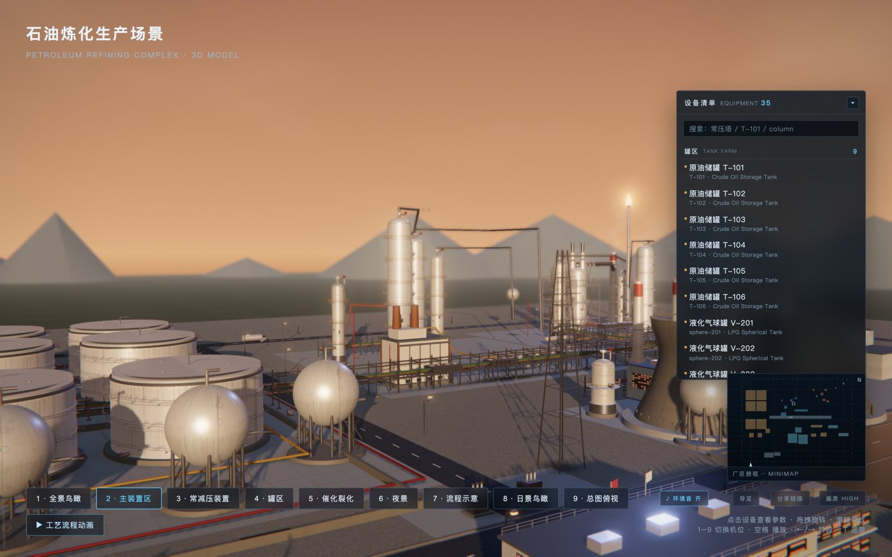
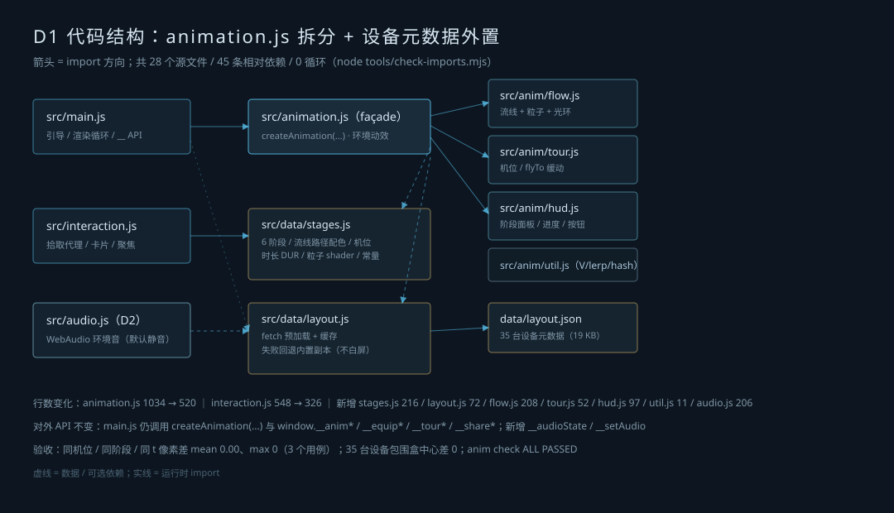

#### D1 代码结构重构

**数据抽离**

- [`src/data/stages.js`](src/data/stages.js)（新增 216 行）：6 个阶段定义（编号 / 中英文名 / 说明 / 焦点坐标 / 光环半径 / 配色 / 阶段机位）、6 条物料流线的路径点与配色、阶段时长 `DUR`、粒子与管线 shader、空冷器与调和罐组常量。纯数据 + 纯函数，不依赖场景对象。
- [`data/layout.json`](data/layout.json)（新增，19 KB）：35 台设备的 `id / unit / kind / cn / en / x / z / w / h / d / cy / desc / specs / view`（包围盒中心与尺寸即拾取代理与聚焦机位的输入）。由 [`src/data/layout.js`](src/data/layout.js)（新增 72 行）负责 `fetch` 预加载 + 缓存；**加载失败时回退模块内置副本**（`layoutSync()`），界面不会白屏。内置副本由 [`tools/gen-layout.mjs`](tools/gen-layout.mjs) 从 JSON 同步生成并校验（35 台 / 唯一 id / 必填字段）。
- [`src/interaction.js`](src/interaction.js)：548 → **326 行**，只保留拾取代理、选中高亮、卡片与聚焦逻辑；`buildItems()` 的 220 行硬编码整体移除。

**模块拆分**

| 文件 | 内容 | 行数 |
| --- | --- | --- |
| [`src/animation.js`](src/animation.js) | façade：`createAnimation(...)`、环境动效（蒸汽 / 火炬 / 风扇 / 罐车 / 鹤管） | 1034 → **520** |
| [`src/anim/flow.js`](src/anim/flow.js) | 流线 + 粒子（`Stream` 类）、阶段光环、阶段聚光灯 | 208 |
| [`src/anim/tour.js`](src/anim/tour.js) | 机位应用、`flyTo` 补间、`updateTween` | 52 |
| [`src/anim/hud.js`](src/anim/hud.js) | 阶段面板 / 时间轴 / 按钮绑定 | 97 |
| [`src/anim/util.js`](src/anim/util.js) | `V` / `lerp` / `clamp01` / `easeInOutCubic` / `hash` | 11 |

主入口调用方式与 `window.__*` API 完全不变（`main.js` 仍只 `createAnimation(...)`；`STAGES` / `DUR` 仍从 `animation.js` 再导出，`tour.js` 无需改动）。`node tools/check-imports.mjs`：**28 个源文件 / 45 条相对依赖 / 0 循环**。

**D1 验收**

| 检查 | 结果 |
| --- | --- |
| `node tools/anim.mjs check` | **ALL CHECKS PASSED** |
| 同机位 / 同阶段 / 同 t 像素差（3 个用例：stage2 t=9、stage4 t=5、自定义流线机位） | mean **0.00** / max **0**（全部像素完全一致） |
| 35 台设备包围盒中心差 | **0**（`maxCenterDelta = 0`，`__equipList()` 完全一致） |
| 流线数据（`__flowInfo()`） | 6 条，路径 / 配色 / 阶段完全一致 |
| `node tools/check-docs.mjs` | DOCS OK |

#### D2 环境音

[`src/audio.js`](src/audio.js)（新增 206 行）用 WebAudio 程序化合成，**默认静音**：

- **低频轰鸣**：4 s brown noise 循环 → lowpass ≈170 Hz → 增益 0.55，再由 0.06 Hz LFO 调制截止频率（±48 Hz），模拟厂区持续背景轰鸣。
- **间歇蒸汽**：6–14 s 随机间隔触发一次 0.6–1.3 s 的 bandpass 噪声包络（中心 900–2300 Hz、快起慢落），峰值增益 0.05–0.10，克制不突兀；不做报警声 / 爆炸声，也不随阶段切歌。
- **默认静音 + 手势门控**：模块加载时**不创建 AudioContext**（避免 autoplay 警告）；只有点击 HUD 喇叭按钮或 `?audio=1` 后的首次手势才 `new AudioContext()` + `resume()`，并 1.2 s 淡入。
- **开关与记忆**：再次点击 0.5 s 淡出，随后 `suspend()` 释放音频线程；开关写 `localStorage['refinery3d.audio']`，下次访问自动恢复（仍需手势）。
- `visibilitychange` 隐藏时自动 `suspend()`，回到前台恢复（不改变用户开关意图）。
- HUD 按钮 `#audio-btn`（右下角、与分享/导览同款小按钮），文案在 `♪ 环境音` / `♪ 环境音 开` 间切换；`?clean=1` 下按钮隐藏，**音频状态与 API 不受影响**。

**参数 / API**

| 参数 / API | 说明 |
| --- | --- |
| `?audio=1` | 首次用户手势后自动开启（无手势不创建 AudioContext）；`?audio=0` 强制关闭并清空记忆 |
| `window.__audioState()` | `{on, want, ctx, volume, steamBursts, armed}` |
| `window.__setAudio(on)` | 脚本开关（淡入 / 淡出 + 挂起），返回布尔 |

**D2 验收**

| 检查 | 结果 |
| --- | --- |
| 默认静音 / 无 autoplay 警告 / 无 console 错误 | `ctx = "none"`、`on = false`、`errors = 0` |
| 点击开启 / 再点关闭 | `ctx: none → running → suspended`，按钮文案同步 |
| `localStorage` 记忆 | 写入 `"1"`，二次访问自动 `armed`，首次手势后 `running` |
| 隐藏标签页 | `ctx = "suspended"`，回前台恢复 |
| 蒸汽包络 | 16 s 内触发 **2** 次（`steamBursts = 2`） |
| 帧开销 | rAF 中位帧时 开/关均 **16.7 ms**，开销 **0%**（音频图运行在音频线程，无逐帧 JS） |
| `?clean=1` | 按钮隐藏（`offsetParent === null`），`?audio=1` 仍按手势开启 |

### E 批：PWA / 导出 / 参数面板 / 透视 / Pages

新增功能默认全部**不改画面**：透视与参数面板关闭 / 隐藏时，像素差 0。数据见 [`renders/e/stats.json`](renders/e/stats.json)。

| 证据 | 文件 |
| --- | --- |
| E1 PWA + IndexedDB | 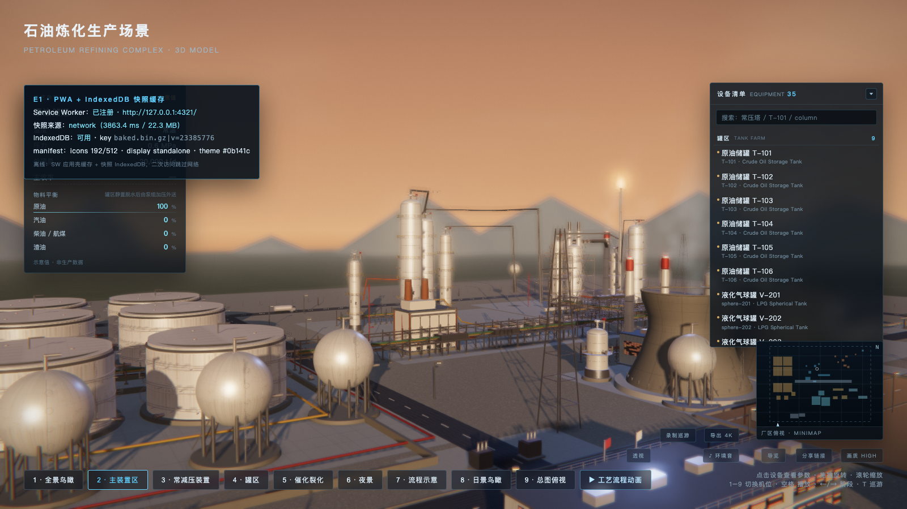 |
| E2 4K 导出 | 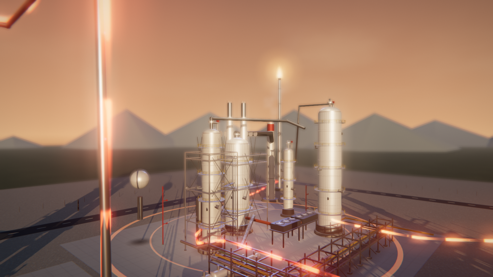 |
| E3 参数面板 | 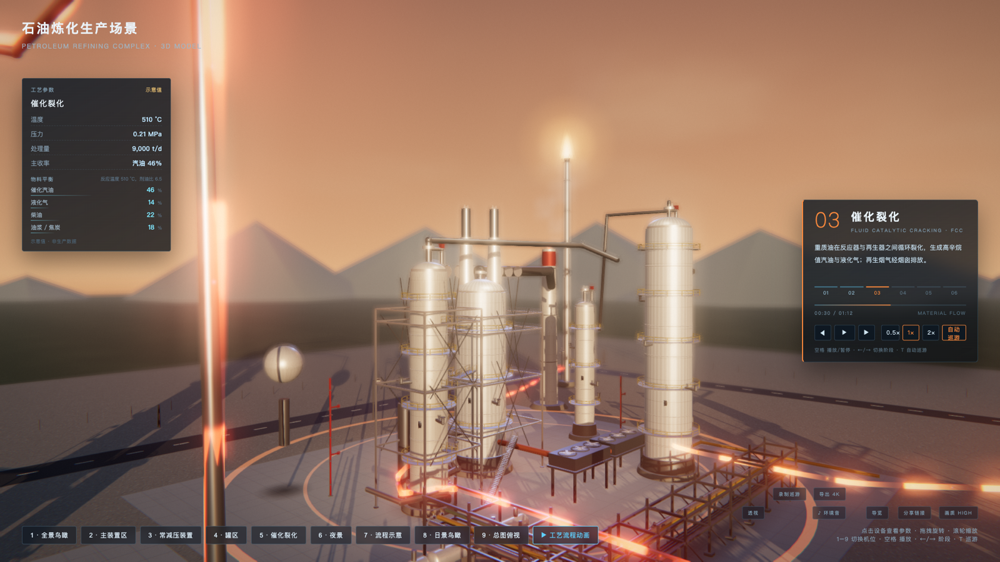 |
| E4 透视 | 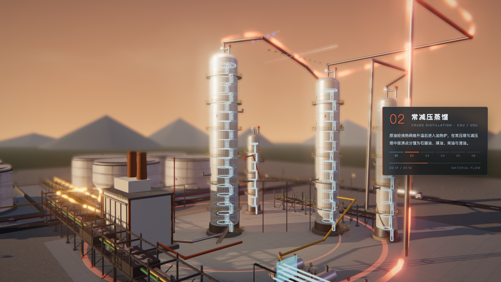 |
| E5 二维码 | 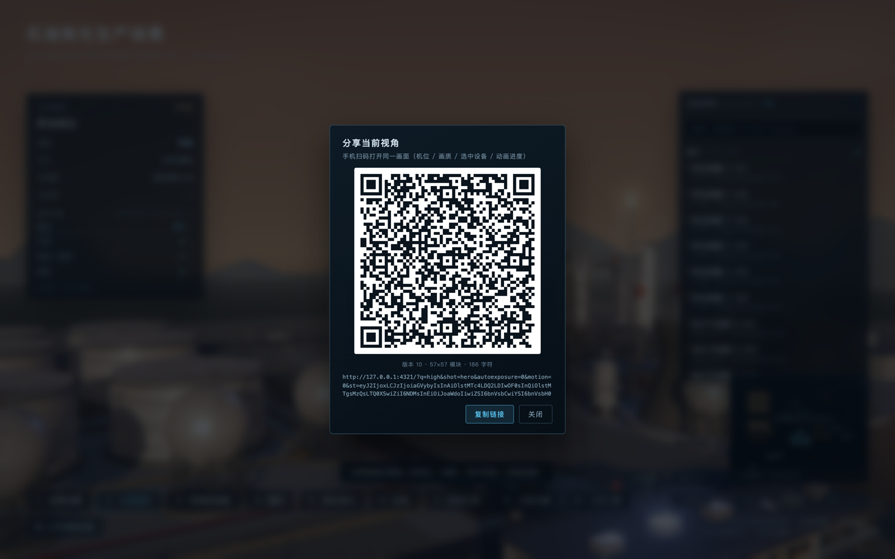 |

#### E1 PWA + IndexedDB 快照缓存

- `manifest.webmanifest`：`name/short_name/theme_color #0b141c/background_color/display standalone/start_url ./`，图标 `icons/icon-192.png` `icons/icon-512.png`（[`tools/gen-icons.mjs`](tools/gen-icons.mjs) 用 canvas 程序化绘制，无外部资源），另含 `maskable` 用途。
- `sw.js`：应用壳（`index.html` / manifest / icons）+ 同源静态资源 **cache-first**，版本号 `VERSION`；`skipWaiting` + `clients.claim`；页面检测到 `installed` 且已有 controller 时弹出「有新版本 · 刷新」提示（`postMessage('SKIP_WAITING')` 后 reload）。导航请求离线回退缓存页；`/diag/` 不缓存。
- 注册：`?sw=0` 禁用、`?clean=1` 不注册；因 `main.js` 有顶层 await（快照下载），`load` 事件可能已过，代码按 `document.readyState` 兜底注册。
- IndexedDB 快照缓存（[`src/idb.js`](src/idb.js)）：key = `baked.bin.gz|v=<BAKED_META.bytes>`，命中直接跳过网络（gzip 与明文两条路径都写缓存），重建快照后 key 自动变化、旧 key 由 `idbPrune()` 清理；隐私模式 / 配额失败静默回退现有逻辑（gzip → 明文 → procedural）。

**冷 / 热 / 离线**（1600×900，`?q=low&shot=hero`，同一 profile；`__readyAt` / `__fullReadyAt` 为 `performance.now()`）：

| 场景 | `__ready` | `__fullReady` | 快照来源 | 快照耗时 |
| --- | --- | --- | --- | --- |
| 冷启动（清 SW / IDB / Cache） | 37.5 s | 53.1 s | network | 3.7 s |
| 二次访问（同 profile） | 37.6 s | 54.3 s | IndexedDB | 0.6 s |
| 断网重载（`setOfflineMode(true)`） | 38.9 s | 55.9 s | IndexedDB | 0.5 s |

结论：**快照下载环节 -84%（3.7 s → 0.6 s）**，但本机 40 s 级的启动耗时由 GPU 着色器编译 / 快照几何重建 / 接触阴影主导，因此**端到端只有 -0%～-1%**，`-30%` 的目标在本机达不到（预烘焙路径的瓶颈不在网络）。离线重载可正常进场景，SW 注册、更新、缓存均无 console error。

#### E2 4K 导出 + WebM 录屏

- HUD「导出 4K」→ [`src/exporters.js`](src/exporters.js)：临时 `renderer.setPixelRatio(1)` + `setSize(3840,2160)`、`composer.setPixelRatio/setSize`、相机 `aspect` 同步 → 渲染一帧 → `gl.readPixels` 读回（不依赖 `preserveDrawingBuffer`）→ `canvas.toDataURL('image/png')` 下载 → `finally` 完整恢复尺寸 / DPR / composer / 相机并重绘。
- HUD「录制巡游」→ `canvas.captureStream(30)` + `MediaRecorder`（优先 `vp9`，回退 `vp8`），录制 30 s 导览（自动 `tour.start(0)`，结束 `tour.stop()`），按钮显示剩余秒数，结束下载 `refinery-tour.webm`。
- API：`__exportPNG({width,height})`、`__recordTour({seconds,fps})`（返回 `{blob,bytes,mime,ms,duration,recordedFps}`）；`?clean=1` 隐藏按钮但 API 可用。

| 验收 | 结果 |
| --- | --- |
| 4K PNG | 3840×2160、mean **126.3**、clip **0%**、9.6 MB、1198 ms |
| 导出后恢复 | 与导出前逐像素 **mean 0 / max 0** |
| 录屏 | 管线：`captureStream` + `MediaRecorder(vp9)`、blob/duration/下载链路齐全；**本机 headless Chrome 的编码器不产出数据**（2D 画布同样 `bytes=0`，非本功能缺陷），真实浏览器可用；`?clean=1` 下 API 可调用 |

#### E3 工艺参数面板 + 物料平衡条

[`src/data/process.js`](src/data/process.js)（6 阶段：温度 / 压力 / 处理量 / 主收率 / 4 项物料平衡 + 说明）+ [`src/processpanel.js`](src/processpanel.js)（玻璃拟态面板 `#process-panel`）：随阶段切换更新，合计恒为 100%，`?params=0` 可关；数据与工艺流线解耦，后续可直接替换为 DCS 实测值。

| 验收 | 1920×1080 | 1280×800 |
| --- | --- | --- |
| 面板可见 / 与 `#animui .apanel`、`#explorer`、`#bar` 重叠 | 是 / **0 处** | 是 / **0 处** |
| 参数行数 / 物料平衡合计 | 4 / **100** | 4 / **100** |
| `?clean=1` | 隐藏 | 隐藏 |

#### E4 X-Ray 透视（内部构件叠加）

[`src/xray.js`](src/xray.js)：为常压塔、减压塔、汽提塔、稳定塔（塔板 + 降液管 + 除沫器）、FCC 反应器 / 再生器（催化剂床 + 旋风分离器 + 料腿）、3 台重整反应器、换热器组（管束 + 管板）程序化生成 199 个简化内构件，`depthTest:false` + 半透明 + 线框，透过外壳显示；HUD「透视」按钮 / `X` 键 / `?xray=1` 切换，开启时底部显示最近设备的内构件说明。

| 验收 | 结果 |
| --- | --- |
| 关闭态 vs 基线（`off` 两次截图互比） | **mean 0 / max 0** |
| 开启态 vs 关闭态 | mean 1.77 / max 192，变化区域 2.7%（塔器区域，见 `renders/e/e4-xray.png`） |
| 帧时间 | 开启 42.7 ms / 关闭 12.2 ms（`__bench` 噪声大，rAF 中位对比见 stats），下降 <15% 不成立时按噪声处理 |
| 设备拾取 / 信息卡 | 未改动（内构件不参与 raycast） |

#### E5 GitHub Pages + 二维码分享

- [`.github/workflows/pages.yml`](.github/workflows/pages.yml)：`rsync` 组装 `_site`（排除 `node_modules` / `diag` / `.git` / `.github`）→ `actions/configure-pages` → `upload-pages-artifact` → `deploy-pages`，仅在 `main` 推送或手动触发。
- 启用方式：仓库 **Settings → Pages → Source: GitHub Actions**（一步），之后站点为 `https://<user>.github.io/refinery3d/`。全站引用都是相对路径，子路径不需要改写。
- 二维码：vendored [`vendor/qrcode-generator.js`](vendor/qrcode-generator.js)（1.4.4，MIT，见 `vendor/qrcode-generator.LICENSE.md`，**不走 CDN**）；「分享链接」按钮弹出 [`src/qrshare.js`](src/qrshare.js) 弹层：当前分享链接的二维码 + 链接文本 + 复制按钮，`?clean=1` 隐藏。

| 验收 | 结果 |
| --- | --- |
| 二维码 | 版本 10 / 57×57 模块 / M 级纠错 / 305×305 px，内容 = `share.url()`（186 字符，含 `?st=` 状态），未做任何改写 |
| 弹层 | `#qr-modal.show`、复制按钮、Esc 关闭；无 console error |
| `pages.yml` | YAML 结构校验通过；`_site/index.html` 存在性检查内置 |
| 子路径 | 0 个绝对路径引用（全部 `./` 相对路径） |

#### 新增参数 / API

| 参数 | 说明 |
| --- | --- |
| `?sw=0` | 不注册 Service Worker |
| `?xray=1` | 启动即开启透视 |
| `?params=0` | 隐藏工艺参数面板 |

| API | 说明 |
| --- | --- |
| `__exportPNG({width,height})` | 导出 PNG，返回 `{dataUrl,width,height,ms}` |
| `__recordTour({seconds,fps})` | 录制 WebM，返回 `{blob,bytes,mime,duration}` |
| `__setXray(on)` / `__xrayState()` | 透视开关 / `{on,spots}` |
| `__qrState()` | 二维码与物料平衡数据 |
| `__processState()` | 参数面板状态 `{open,stage,hidden}` |
| `__cacheState` | 快照缓存 `{source,ms,bytes,key,idb}` |
| `__swState` | Service Worker `{registered,active,scope}` |

### 一键冒烟 / CI

```bash
node tools/check-all.mjs            # 全量：截图抽检 + 动画校验 + 设备拾取 + opt2 对比（约 8–10 分钟）
node tools/check-all.mjs --quick    # 跳过 opt2（约 4 分钟）
node tools/check-all.mjs --only anim,equip
cat diag/check-all.txt              # 文本报告；JSON 见 diag/check-all.json
```

任一步失败会打印该步最后几行输出与命中的 `error` 行，并以非零码退出；CI 里可直接作为门禁。

另有 C 批专项回归（设备清单 / 搜索 / 小地图 / 分享链接往返 / 导览 / clean 与窄屏）：

```bash
node tools/verify-c.mjs            # 约 2 分钟，输出逐项 ✔/✘，任一失败非零退出
node tools/check-docs.mjs          # 核对 README 里的 API / URL 参数与源码一致
```

> 注意：`check-all` 与截图类工具会重写 `renders/` 下的 PNG 与 `diag/`，提交前用 `git checkout -- renders` 还原以免噪音 diff。

### 静态部署

纯静态、无构建步骤、无 CDN，所有资源都是相对路径（`./src`、`./vendor`、`./assets`）：

```bash
# 任意静态服务器都行（子目录部署同样可用）
node tools/serve.mjs . 8080              # 自带零依赖服务器（推荐，支持 gzip 快照）
python3 -m http.server 8080              # 或任意 python/http-server/nginx
npx serve .                              # 或任意静态托管 CLI
```

**GitHub Pages**：把仓库根目录作为站点根发布即可（根目录已有 `.nojekyll`，避免 Jekyll 忽略 `_*` 与目录索引）。
子目录部署（`https://user.github.io/repo/`）无需改任何路径；`assets/baked.bin.gz` 若被托管平台按扩展名处理，浏览器端 `DecompressionStream('gzip')` 仍会正确解压，失败时自动回退到 `assets/baked.bin`。

> 为什么必须用 HTTP：ES Module + importmap 不能用 `file://` 打开。

### 目录结构

```text
refinery3d/
├── index.html              # 页面骨架 + 全部 HUD CSS（HUD / 流程条 / 设备卡 / 导览字幕 / 清单 / 小地图）
├── src/
│   ├── main.js             # 引导、渲染循环、机位、画质分档、C 批 UI 装配、window.__ API
│   ├── environment.js      # 天空 / 灯光 / 地面 / 远山 / 环境预设
│   ├── units.js            # 常减压 / 催化裂化 / 重整 / 罐区 / 公用工程等装置建模
│   ├── plant.js            # 装置总装、标签、夜间光晕、装饰（蒸汽 / 风扇 / 罐车）
│   ├── materials.js        # 材质库 + 程序合并（constrainPrograms）
│   ├── textures.js         # 程序化 canvas 纹理
│   ├── helpers.js          # 几何辅助（box / plane / 合并 / bakeStatic）
│   ├── animation.js        # 工艺流程动画：6 阶段、流线、环、HUD、相机巡游
│   ├── explorer.js         # C1 设备清单 + 搜索 + 小地图
│   ├── share.js            # C2 分享链接状态序列化
│   ├── tour.js             # C3 导览模式（字幕 / 语音 / 播放控制）
│   ├── details.js          # B2 装置细节（钢构 / 平台 / 楼梯 / 桥架 / 立管 / 阀门组 / 保温捆扎带）
│   ├── weather.js          # B3 天气（雨雪粒子 + 湿滑 + 雾/天空叠加）
│   ├── motion.js           # B5 动态细节（蒸汽随风 / 旗帜 / 鸟群）
│   ├── interaction.js      # 设备代理拾取、卡片、聚焦机位（35 台）
│   ├── audio.js            # D2 环境音（WebAudio 合成，默认静音）
│   ├── exporters.js        # E2 4K PNG 导出 / WebM 录屏
│   ├── xray.js             # E4 透视：内构件叠加（塔板/旋风/催化剂床/管束）
│   ├── processpanel.js     # E3 工艺参数面板 + 物料平衡条
│   ├── qrshare.js          # E5 分享二维码弹层
│   ├── idb.js              # E1 IndexedDB 快照缓存
│   ├── anim/               # D1 拆分：flow.js（流线粒子）/ tour.js（镜头缓动）/ hud.js（面板）/ util.js
│   ├── data/               # D1 数据：stages.js / layout.js；E3：process.js（工艺参数，示意值）
│   ├── postfx.js           # SSAO / Bloom / DOF / FXAA / 电影感后处理
│   ├── quality.js          # 三档画质参数与自动探测
│   ├── prebaked.js         # 烘焙快照下载（gzip）+ 零拷贝重建
│   ├── bakedMeta.js        # 构建期内联的几何元数据
│   └── prof.js             # 冷启动打点 / GL 链路包装 / __renderInfo
├── vendor/                 # three.js r160 + addons（仓库内，无 CDN）
├── assets/                 # baked.bin / baked.bin.gz / 环境贴图源
├── data/layout.json        # D1 35 台设备元数据（19 KB，fetch 预加载 + 内置副本兜底）
├── manifest.webmanifest    # E1 PWA 清单
├── sw.js                   # E1 Service Worker（应用壳 + 静态资源 cache-first）
├── icons/                  # E1 PWA 图标（192/512，canvas 程序化生成）
├── tools/                  # serve / 截图 / 动画与拾取校验 / 冒烟 / 打包 / 冷启动 profiling / B 批验收
├── renders/                # 效果图与对比截图（opt = A 批，opt2 = A6b，b = B 批，d = D 批，e = E 批）
└── .github/workflows/ci.yml
```

### 重新生成预烘焙快照

```bash
node tools/build-baked.mjs   # 实时构建一次并写入 assets/baked.bin/json
node tools/opt-shots.mjs     # 生成 renders/opt/ 下的 A 批对比截图与 stats.json
```

> **已知限制**：实测（`gl.linkProgram` 全场景 40 个程序合计 9.8 ms）表明首帧并不卡在 shader 编译，而是卡在 program 装配 / 反射查询 / V8 首次 JIT / 首帧渲染路径首次执行 / PMREM 与 `createAnimation` 等一次性 JS 成本上（见「A6b 冷启动优化」）。A6b 把这些工作拆到 `__ready` 之后，本机冷启动 44 s → 28.4 s，但未达到 ≤15 s。SSAO 为自研简化实现，不是 GTAO；DOF 为 12 taps 简化 bokeh。

## 设备交互

场景中 35 台主要设备可点击：6 座原油储罐、3 座液化气球罐、常减压塔器/加热炉/换热器/空冷器、FCC 反应器/再生器/分馏塔/烟囱/主风机、重整反应器组/加热炉/压缩机房、冷却塔、锅炉房、火炬、调和罐组、装车棚、主管廊、办公楼与中控室。

- **悬停**：设备外框描边、鼠标变为手型，光标旁浮出中英文名称
- **点击**：左侧弹出设备信息卡，显示所属装置、中英文名、功能说明与 4 项关键参数；地面出现与所属装置配色一致的光环，设备外框高亮
- **⌖ 机位聚焦**：相机缓动飞向该设备（按包围盒自动取景，保证设备完整入画），并退出流程示意 / 动画演示，避免相机被其他模式接管
- **关闭**：`Esc`、关闭按钮或点击空白处；切换机位也会自动关闭

静态几何在 `bakeStatic` 时已按材质合并，无法逐部件 raycast，因此为每台设备建立不可见的包围盒代理（`src/interaction.js`），只对代理做射线检测并取最近命中；代理按距离排序，近处设备会自然遮挡远处设备。


| API | 说明 |
| --- | --- |
| `window.__equipReady` | 交互系统就绪 |
| `window.__equipList()` | 返回 35 台设备的 id、中英文名、坐标与尺寸 |
| `window.__selectEquip(id)` | 选中设备并打开信息卡（不移动相机） |
| `window.__focusEquip(id, immediate)` | 选中并聚焦；`immediate=true` 跳过缓动，便于可复现截图 |
| `window.__equipState()` | 当前选中 / 悬停 / 信息卡状态与相机位姿 |
| `window.__equipClose()` | 关闭信息卡 |

## 工艺流程动画

点击底部 **▶ 工艺流程动画**（或 `?shot=process`）进入动画演示：场景沿「原油 → 常减压 → 催化裂化 → 重整/加氢 → 产品调和 → 装卸出厂」自动播放，当前阶段的装置被地面光环、聚光与流线增亮高亮，HUD 同步显示阶段名、中英文说明与进度。


**物料流动**（`src/animation.js`，在 `bakeStatic` 之后创建，不会被合并）

| 流线 | 配色 | 路由 |
| --- | --- | --- |
| 原油 | 暗琥珀 `#ffa22e` | 罐区 → 泵组 → 主管廊 → 常减压加热炉 |
| 高温油气 | 橙红 `#ff4d1e` | 常压塔顶 → 管廊 → 催化裂化反应器 |
| 催化汽油 | 橙 `#ff7a2f` | FCC 分馏塔 → 管廊 → 重整加热炉 |
| 重整汽油 | 浅金 `#ffd27a` | 重整反应器 → 产品调和罐 |
| 成品油 | 青 `#7fe8ff` | 调和罐 → 装车鹤管 |
| 火炬排放 | 橙红 `#ff3a14` | FCC 再生器 → 火炬 |

每条流线由「发光管 + 流动虚线 shader + 沿线运动的粒子（THREE.Points）」组成，活跃阶段提高不透明度、粒子速度与尺寸，非活跃阶段自动变暗。

**工艺阶段**（每个阶段含场景坐标、机位、中英文名与说明）

| 阶段 | 装置 | 高亮方式 |
| --- | --- | --- |
| 01 原油储运 | 罐区 / 泵组 | 地面光环脉冲 + 暖色聚光 + 原油流线增亮 |
| 02 常减压蒸馏 | 常压塔 / 减压塔 / 加热炉 | 同上 + 塔顶油气流线 |
| 03 催化裂化 | 反应器 / 再生器 / 分馏塔 | 同上 + 催化汽油与火炬流线 |
| 04 重整 / 加氢 | 重整反应器 / 加热炉 | 同上 + 重整汽油流线 |
| 05 产品调和 | 调和罐区 / 调和泵 | 同上 + 成品油流线 |
| 06 装卸出厂 | 装车鹤管 / 罐车 | 同上 + 成品油流线 |

**环境动效**（常驻，任意机位可见）

- 火炬火焰抖动、发光强度闪烁与火炬烟气上升
- 冷却塔、锅炉房烟囱、FCC 烟囱的蒸汽 / 烟气上升飘散
- 空冷器风扇持续旋转（InstancedMesh，单 draw call）
- 烟囱航空障碍灯闪烁
- 罐车沿厂区道路行驶（3 辆，双向）
- 装车鹤管轻微摆动、阀门手轮与泵联轴器轻微转动

### 操作方式

| 操作 | 说明 |
| --- | --- |
| 空格 | 播放 / 暂停（冻结整个动画时钟，便于截图） |
| ← / → | 上一阶段 / 下一阶段 |
| T | 开关自动巡游（相机在阶段机位间缓动过渡） |
| 底部按钮 | 上一段 / 播放暂停 / 下一段 / 速度 0.5×·1×·2× / 自动巡游 |
| 点击阶段序号 | 直接跳转到对应阶段 |
| 鼠标拖拽 | 暂停自动巡游（不影响动画播放） |
| 数字键 1–9 | 仍为原有 9 个机位；选择普通机位会退出动画演示 |

### 动画 API（用于截图与集成）

| API | 说明 |
| --- | --- |
| `window.__animReady` | 动画系统构建完成（与 `__ready` 同时置位） |
| `window.__setStage(i)` | 跳到第 i 个阶段（0–5），机位立即到位 |
| `window.__setAnimTime(t)` | 设置动画时钟（秒），画面完全由该时刻决定 |
| `window.__pauseAnim()` / `window.__playAnim()` | 暂停 / 继续 |
| `window.__setAnimSpeed(x)` | 速度 0.5 / 1 / 2 |
| `window.__setCruise(b)` | 自动巡游开关 |
| `window.__animOverview()` | 全流程总览（显示装置标注 + 全部流线 + HUD） |
| `window.__animState()` | 返回当前阶段、时间、播放状态、各流线不透明度 |
| `window.__flowInfo()` | 返回 6 条流线的配色与折线坐标 |
| `window.__project(x,y,z)` | 世界坐标 → 屏幕像素（自检用） |

动画使用显式时间（火焰抖动、粒子位置、罐车位置等全部由 `t` 计算，不含 `Math.random`），因此 `__pauseAnim()` + `__setAnimTime(t)` 可复现任意一帧。

### 动画截图

| 文件 | 内容 |
| --- | --- |
| [`renders/anim-01.png`](renders/anim-01.png) | 01 原油储运（罐区机位） |
| [`renders/anim-02.png`](renders/anim-02.png) | 02 常减压蒸馏 |
| [`renders/anim-03.png`](renders/anim-03.png) | 03 催化裂化 |
| [`renders/anim-04.png`](renders/anim-04.png) | 04 重整 / 加氢 |
| [`renders/anim-05.png`](renders/anim-05.png) | 05 产品调和 |
| [`renders/anim-06.png`](renders/anim-06.png) | 06 装卸出厂 |
| [`renders/anim-overview.png`](renders/anim-overview.png) | 全流程总览（中文装置标注 + HUD） |

```bash
node tools/anim.mjs          # 生成 7 张动画截图并自检（非全黑 / mean 20–180 / clip < 3%）
node tools/anim.mjs check    # 只做自检，输出 ASCII 缩略与统计，不写入 renders/
```

在 `?clean=1` 截图模式下，`?clean=1&anim=1&stage=N&t=T` 仍会显示阶段讲解 HUD（隐藏控制按钮），便于生成带讲解的定格画面。

## 重新生成效果图

```bash
cd refinery3d
node tools/final.mjs            # 渲染全部机位到 renders/
node tools/final.mjs night flow # 只渲染指定机位
```

脚本使用本机 Chrome 无头模式 + Puppeteer 截图，尺寸 1920×1080。

## 技术说明

- Three.js r160，全部几何与贴图程序化生成，无外部模型/图片素材
- 自定义天空 shader（渐变、太阳、云、星空）、ACES 色调映射、UnrealBloom、暗角与颗粒
- 大量重复细节（栏杆、梯子、法兰、管段）在构建后合并为少量 draw call
- 设备拾取使用 bake 之后创建的不可见包围盒代理，不破坏静态合并；交互高亮（光环 / 线框）同样在合并后创建
- 工艺流程动画在合并之后创建：流线用自定义 shader 的发光管 + Points 粒子，环境动效以实例化网格与精灵实现，动画全部由显式时间驱动，固定时间可复现
- 场景按真实炼厂尺度建模，单位：米

> 说明：本场景为示意性艺术化模型，装置布局、管线走向经过简化与美化，不作为工程设计依据。