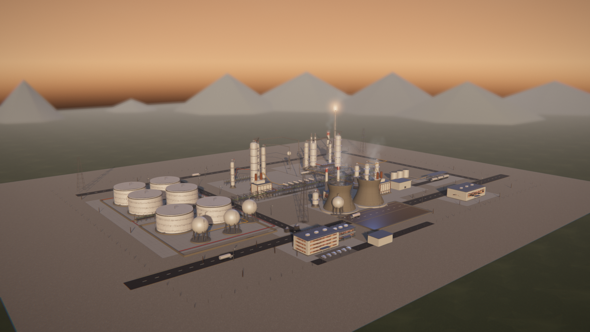
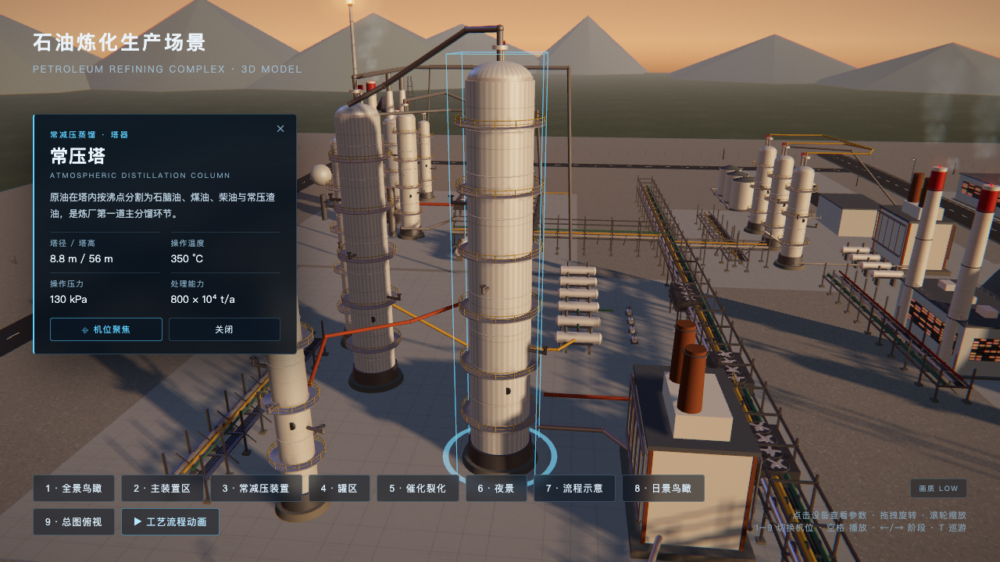

# 石油炼化厂 · 3D 场景与效果图

一个用 Three.js 程序化搭建的石油炼化厂三维场景：从原油储运、常减压蒸馏、催化裂化、连续重整到产品装卸的完整厂区，包含塔器、加热炉、换热器、储罐、球罐、冷却塔、管廊、火炬等典型炼化装置，并附带黄昏 / 白昼 / 夜景三套光照与 9 个机位的效果图。



## 效果图

| 文件 | 内容 | 光照 |
| --- | --- | --- |
| [`renders/aerial.png`](renders/aerial.png) | 全景鸟瞰 | 黄昏 |
| [`renders/hero.png`](renders/hero.png) | 主装置区（常减压 + 管廊） | 黄昏 |
| [`renders/cdu.png`](renders/cdu.png) | 常减压蒸馏装置特写 | 黄昏 |
| [`renders/fcc.png`](renders/fcc.png) | 催化裂化装置 + 火炬 | 黄昏 |
| [`renders/tanks.png`](renders/tanks.png) | 原油罐区 | 黄昏 |
| [`renders/night.png`](renders/night.png) | 厂区夜景（蓝调时刻） | 夜景 |
| [`renders/flow.png`](renders/flow.png) | 工艺流程示意（中文标注 + 流程条） | 黄昏 |
| [`renders/day.png`](renders/day.png) | 日景鸟瞰 | 白昼 |
| [`renders/top.png`](renders/top.png) | 总图俯视 | 白昼 |

## 场景构成

| 区域 | 主要构筑物 |
| --- | --- |
| 原油罐区 | 6 座浮顶储罐（直径 34 m）、3 座 LPG 球罐、防火堤、罐区管廊与泵组 |
| 常减压蒸馏 CDU/VDU | 常压塔（56 m）、减压塔、汽提塔、稳定塔、圆筒加热炉、换热器组、空冷器 |
| 催化裂化 FCC | 反应器、再生器（含旋风分离器）、主分馏塔、烟机烟囱、气压机、催化剂罐 |
| 连续重整 CCR | 3 台重整反应器、重整加热炉、压缩机房、换热器、循环管系 |
| 公用工程 | 2 座双曲线冷却塔、锅炉房与烟囱、水处理、变电所、输电塔 |
| 产品调和 | 3 座调和罐、调和泵组、成品油管线 |
| 产品装卸 | 装车鹤管、罐车、装卸管廊 |
| 火炬系统 | 74 m 高火炬、火焰与烟气 |
| 其他 | 全厂管廊、道路与标线、办公楼/中控室、仓库、围栏、路灯、绿化 |

## 交互式场景

场景需要以 HTTP 方式打开（ES Module 限制），仓库自带一个零依赖静态服务器：

```bash
cd refinery3d
node tools/serve.mjs . 4321
# 浏览器打开 http://127.0.0.1:4321/
```

- 鼠标拖拽旋转、滚轮缩放、右键平移
- 数字键 `1`–`9` 或底部按钮切换机位
- 点击设备查看参数，详见下节
- URL 参数：`?shot=night` 指定初始机位、`?clean=1` 隐藏界面（用于截图）

## 画质与性能（A 批优化）

场景提供三档画质，默认按设备能力自动选择；也可用 URL 参数强制指定。

| 档位 | Pixel Ratio 上限 | 阴影贴图 | Bloom | SSAO | 接触阴影 | FXAA | 景深 | 夜间点光 |
| --- | --- | --- | --- | --- | --- | --- | --- | --- |
| **high** | 2.0 | 2048² | 开 | 开 | 开 | 开 | 机位截图 / 巡游 | 12 |
| **mid** | 1.5 | 1024² | 开 | 关 | 开 | 开 | 关 | 6 |
| **low** | 1.2 | 512² | 关 | 关 | 关 | 关 | 关 | 2 |

自动选择规则：`hardwareConcurrency <= 4` 或 `devicePixelRatio > 2` → low；触屏 / 窄屏（< 1024 或高 < 720）→ mid；其余桌面 → high。右下角「画质 HIGH」小按钮可在三档间循环，`clean=1` 截图模式自动隐藏。

### URL 参数

| 参数 | 说明 |
| --- | --- |
| `?q=high / mid / low` | 强制画质档位；显式指定时禁用自动降档 |
| `?stats=1` | 左上角显示 FPS / draw calls / triangles / 档位面板；按 `P` 切换 |
| `?prebaked=1` | 加载构建期烘焙几何快照（默认开启） |
| `?procedural=1` | 回退到实时程序化建模 + `bakeStatic`（兼容/调试） |
| `?dof=1` / `?dof=0` | 强制开启 / 关闭景深 |
| `?autoexposure=0` | 关闭自动曝光（曝光锁定在预设值） |
| `?autoq=0` | 关闭 FPS 自动降档 |
| `?clean=1` | 隐藏 HUD，用于可复现截图（同时禁用自动降档） |

### 性能数据（本机无头 Chrome + ANGLE Metal，1920×1080）

| 指标 | 数值 |
| --- | --- |
| high 交互 FPS（景深关闭） | ≈ 33.4（1920×1080） |
| high 截图 FPS（景深开启） | ≈ 28.3（景深开销 15.3%） |
| high 交互 FPS（1280×720） | 60（vsync 上限） |
| low 交互 FPS（1280×720） | 60（vsync 上限） |
| high draw calls / triangles | 244 / ≈ 1.05 M（预烘焙路径；`__perf()` 的 calls 会累加 composer 各 pass） |
| 冷启动到 `__ready`（预烘焙，high） | ≈ 28.4 s（A6b，3 次中位 28.1–29.2；A 批 ≈ 44 s） |
| 冷启动到 `__fullReady`（完整画质） | ≈ 41 s（`__ready` 后约 12 s 补齐） |
| 同 profile 二次加载（warm → `__ready`） | ≈ 27.8 s（本机无磁盘 program 缓存，与冷启动接近） |
| 冷启动到 `__ready`（`?procedural=1`，high） | ≈ 42.8 s（A6b；A 批 ≈ 62 s） |
| 预烘焙相对实时代码构建的冷启动降幅 | ≈ 27–29% |

> 测试环境为无头软件渲染（`--enable-unsafe-swiftshader --use-angle=metal`），实际带独立 GPU 的桌面浏览器会明显更快；1280×720 下 high/low 都可能被 60 Hz vsync 截顶，因此低档收益主要体现在 1920×1080 与移动端高 DPR 场景。首帧主要受 40+ 材质变体的 GPU shader 编译限制。

### A 批对比截图

| 文件 | 内容 |
| --- | --- |
| [`renders/opt/a1-aerial.png`](renders/opt/a1-aerial.png) | A1：PMREM 环境光照 · 鸟瞰 |
| [`renders/opt/a1-hero.png`](renders/opt/a1-hero.png) | A1：主装置区 |
| [`renders/opt/a2-low.png`](renders/opt/a2-low.png) | A2：low 档，1280×720 |
| [`renders/opt/a3-cdu.png`](renders/opt/a3-cdu.png) | A3：SSAO + 接触阴影 · 常减压特写 |
| [`renders/opt/a4-shadow.png`](renders/opt/a4-shadow.png) | A4：阴影相机收紧（AO 关闭以隔离阴影） |
| [`renders/opt/a5-cinematic.png`](renders/opt/a5-cinematic.png) | A5：景深 + 色差 / 暗角 / 颗粒 |
| [`renders/opt/a6-prebaked.png`](renders/opt/a6-prebaked.png) | A6：默认预烘焙路径冷启动 |

统计（均值 / 暗部占比 / 过曝占比 / 帧耗时）见 [`renders/opt/stats.json`](renders/opt/stats.json)。

### 程序化 API

| API | 说明 |
| --- | --- |
| `window.__quality` | 当前档位 |
| `window.__setQuality(q)` | 切换档位并重建 render target 尺寸，返回当前档位 |
| `window.__perf()` | `{fps, calls, triangles, quality, pixelRatio, ao, dof, fxaa, bloom, exposure}` |
| `window.__setStats(on)` | 显示 / 隐藏性能面板 |
| `window.__bench(n)` | 同步渲染 n 帧，返回 `msPerFrame` / `fps`（绕过 vsync） |
| `window.__setDof(on)` | 强制景深开关 |
| `window.__setAO(on)` / `__setContactShadows(on)` / `__setBloom(on)` / `__setFXAA(on)` | 分项调试开关 |
| `window.__shadowInfo()` | 当前阴影相机尺寸、贴图大小与焦点 |
| `window.__renderInfo()` | 程序数 / 按材质分组 / render 统计 / 显存 / GPU 与 `KHR_parallel_shader_compile` |
| `window.__timing()` | 冷启动分段 `perf.mark` 列表（含 GL 链路耗时汇总） |
| `window.__fullReady` | 完整画质（装饰 / PMREM / postFX / 完整档位）是否就绪 |

### A 批改动

- **A1 环境光照**：用天空 shader 通过 `PMREMGenerator.fromScene()` 生成 PMREM 环境图，dusk/day/night 三套缓存；金属、玻璃、水面使用更高 `envMapIntensity`，混凝土、沥青、植被保持低位；重新标定曝光，避免场景发灰/过曝。
- **A2 画质分档**：high/mid/low 三档控制 pixel ratio、阴影贴图、Bloom、SSAO、接触阴影、FXAA、景深、夜间点光数量；新增 HUD 切换按钮、性能面板、`?q` / `?stats` / `?autoq` 参数；连续 5 s FPS < 35 自动降一档。
- **A3 AO / 接触阴影**：vendor 未附带 GTAO/SSAO/SMAA，故自行实现基于 RenderPass 深度纹理的 SSAO（10 taps、保守强度）；为罐区、塔器、建筑、冷却塔、装车棚等设备底部加入合并为单 draw call 的程序化接触阴影（`bakeStatic` 之后加入，避免合并）。
- **A4 阴影 / 抗锯齿**：阴影相机按机位焦距收紧（近景 cdu 焦区约 ±95 m，2048² 贴图下约 0.09 m/texel），相机拖拽时节流重算；新增 FXAA pass，high/mid 开启，low 关闭。
- **A5 电影感后处理**：色差、柔暗角、细颗粒、±8% 缓慢曝光自适应；景深只在机位截图 / 巡游时开启，拖拽或流程标签时自动关闭，`?dof=1` 可强制。
- **A6 冷启动**：`tools/build-baked.mjs` 在构建期导出 `bakeStatic` 后的 41 个合并 Mesh（position/normal/uv/index + 材质名）到 `assets/baked.bin`（20.5 MB）/ `assets/baked.json`；运行时默认先 fetch 快照并直接 `BufferGeometry.setAttribute` 重建，跳过 units/plant 构建与 bake；几何元数据内联在 `src/bakedMeta.js`，只下载 20.5 MB 二进制。标签、夜间光晕、蒸汽、火炬火焰、控制室玻璃由 `createPlantDecor()` 补充；`?procedural=1` 可回退。

### A6b 冷启动优化

**测量工具**（新增，先量化再改代码）

\`\`\`bash
node tools/profile-startup.mjs --runs 3          # 冷启动 ×3（各自独立 profile）
node tools/profile-startup.mjs --warm 1          # 同一 profile 连续两次（第二次为 warm）
node tools/profile-startup.mjs --query "?shot=hero" --prep compile   # 指定机位 / 预热方式
\`\`\`

页面内 \`src/prof.js\` 用 \`performance.mark\` 打点（\`window.__t0\` 起算），并包装 \`gl.linkProgram\`、\`gl.compileShader\`、\`gl.bufferData\`、\`gl.drawElements\` 统计真实 GL 链路耗时；结果写入 \`diag/profile-startup.json\`，同时提供 \`window.__renderInfo()\` / \`window.__timing()\` 两个运行时诊断 API。

**实测结论：着色器编译不是瓶颈**（headless Chrome + ANGLE Metal，M1，1920×1080）

| 项 | 实测 |
| --- | --- |
| \`gl.linkProgram\` × 40 个程序 | 9.8 ms |
| \`gl.compileShader\` × 80 个 shader | 7.5 ms |
| 21.1 MB 顶点/索引上传（478 次 \`bufferData\`） | 25 ms |
| 1688 次 draw call 的 GL 调用本身 | 19 ms |

开销集中在 JS 侧的一次性成本：每个 program 的装配 + uniform/attrib 反射 + V8 首次 JIT（首个 ≈1.4 s，之后 20–90 ms）、PMREM \`fromScene\` 3.1–4.4 s、\`bakeStatic\` 2–5 s、首帧渲染路径首次执行 ≈6 s、\`createAnimation\` ≈7 s。所以优化方向是**减少首帧之前必须完成的工作**，而不是微优化 draw / shader。

**首帧渐进升级（staged boot）**

1. 轻量首帧：DPR 1、阴影只保留 define 不渲染贴图（\`shadowMap.autoUpdate = false\`）、无 postFX、无 PMREM 环境图、无标签/蒸汽/夜间光晕、轻量地面（草地 + 砾石两个平面）；
2. \`__ready\` 置位后用 \`requestAnimationFrame\`×2 触发 \`upgradeToFull()\`：装饰 → 完整地面 + 远山 → 接触阴影 → PMREM 环境图 → 完整档位（DPR / 阴影贴图 / composer）→ \`applyLook\` → render → \`__fullReady\`；
3. 所有截图/回归工具改为等待 \`window.__fullReady\`，保证出图仍是完整画质。

**其它改动**

- **材质程序合并**：\`constrainPrograms()\` 给每个 \`MeshStandardMaterial\` 补 1×1 白/黑 \`map\` / \`emissiveMap\`（\`MeshBasicMaterial\` 同理），消除「同材质、不同贴图组合」导致的重复 program，首帧程序数 40 → 6；
- **快照 gzip**：\`assets/baked.bin\` 20.53 MB → \`assets/baked.bin.gz\` 2.92 MB（-85.8%，3057022 B），运行时用 \`DecompressionStream('gzip')\` 解压，浏览器不支持或 404 时回退明文；打包脚本 \`tools/pack-baked.mjs\`；
- **下载提前**：快照 fetch 在建场之前发起，与天空/灯光/轻量地面创建并行；
- **取消运行时 merge**：地面与混合罐组不再调用 \`bakeStatic\`——本环境 draw call 极便宜（19 ms / 1688 draw），合并 60 个网格反而要 2–3 s；合并只保留在构建期（\`build-baked\`）。

**数据**（同机同法，预烘焙路径）

| 指标 | A 批 | A6b | 变化 |
| --- | --- | --- | --- |
| 冷启动 → \`__ready\` | 43.9–45.7 s | 28.1 / 28.4 / 29.2 s（中位 **28.4 s**） | **-35.5%** |
| 冷启动 → \`__fullReady\` | — | 40.8 / 41.1 / 42.2 s（中位 41.1 s） | 首帧后 +12.7 s 补齐 |
| 同 profile 二次加载 → \`__ready\` | — | 27.8 s | 与冷启动基本一致 |
| 轻量首帧 program 数 | 40 | 6 | -85% |
| \`assets/baked.bin\` 传输量 | 20.53 MB | 2.92 MB（gzip） | -85.8% |

冷启动分段（3 次中位，页面内 \`perf.mark\`）：

| 阶段 | 耗时 |
| --- | --- |
| 模块解析 + 渲染器 + 材质初始化 | 3.2 s |
| 快照下载（2.92 MB gzip） | 1.7 s |
| 快照重建 42 个 geometry | 2.2 s |
| \`createAnimation\`（含物流管线/罐车/风机） | 7.0 s |
| 交互系统 + 机位 | 1.2 s |
| 首帧 program 生成（\`renderer.compile\`） | 4.5 s |
| 首帧 \`render\` | 6.0 s |
| 首帧提交 / present | 1.2 s |

**为什么还没到 ≤15 s（剩余瓶颈）**

本机（无头 + ANGLE Metal + 低效 JIT）的固定成本：单个 program 冷装配 0.8–1.4 s、首帧渲染路径首次执行 ≈6 s、\`createAnimation\` 7 s、快照重建首个 item 固定 ≈1.4 s。这些与画质档位无关，单纯删画面也换不回来。

已试并放弃的方案（收益 <5% 或负收益）：

| 方案 | 结果 | 结论 |
| --- | --- | --- |
| \`compileAsync\` 并行链接（\`?prep=compileasync\`） | 链接本身仅 9.8 ms，并行只省 ~10 ms | 无收益 |
| probe 场景预热（1 cube × 全材质 + 64×64 RT） | 预热自身 8.0 s，只抵消后续 4.4 s | 净亏 3.6 s |
| 关闭 \`antialias\` | 首帧 render 6.1 s 不变（最终画面走 composer 的 4×MSAA RT） | 无收益 |
| 运行时 \`bakeStatic(ground / blendGroup)\` | 合并 60 网格 2–3 s，多出的 draw 只值 <1 ms | 移除 |

下一步可行方向（未实施，风险已在表中标注）：把 \`createAnimation\` 整体推迟到 \`upgradeToFull\`（约 -7 s；需给 HUD/流程交互加 stub，风险高）；首帧只画天空+地面占位（可进 15 s，但首帧内容不完整，属于画质回退，不做）；geometry 量化/减面（改动面大、影响视觉）。

**首帧 → 完整画质的已知限制**

\`__ready\` 到 \`__fullReady\` 之间（本机约 12 s）画面缺少：环境反射（金属偏暗偏灰）、阴影、SSAO/DOF/Bloom/FXAA、标签与蒸汽、完整地坪与远山。所有截图与验收都在 \`__fullReady\` 之后采集，逐机位对比见下节。

### A6b 对比截图

| 文件 | 内容 | 均值（vs A 批） |
| --- | --- | --- |
| [\`renders/opt2/a6b-aerial.png\`](renders/opt2/a6b-aerial.png) | 鸟瞰 | 115.1（115.6，-0.5） |
| [\`renders/opt2/a6b-hero.png\`](renders/opt2/a6b-hero.png) | 主装置区 | 121.1（123.1，-2.0） |
| [\`renders/opt2/a6b-cdu.png\`](renders/opt2/a6b-cdu.png) | 常减压特写（SSAO + 接触阴影） | 113.2（113.0，+0.2） |
| [\`renders/opt2/a6b-low.png\`](renders/opt2/a6b-low.png) | low 档 1920×1080 | 115.5 |

均值 / 暗部占比 / 过曝占比 / 性能 / 冷启动分段见 [\`renders/opt2/stats.json\`](renders/opt2/stats.json)；\`node tools/opt2-shots.mjs\` 可重新生成（同时校验与 A 批的均值偏差 ≤ ±5、clip < 1%）。

### 重新生成预烘焙快照

```bash
node tools/build-baked.mjs   # 实时构建一次并写入 assets/baked.bin/json
node tools/opt-shots.mjs     # 生成 renders/opt/ 下的 A 批对比截图与 stats.json
```

> **已知限制**：实测（`gl.linkProgram` 全场景 40 个程序合计 9.8 ms）表明首帧并不卡在 shader 编译，而是卡在 program 装配 / 反射查询 / V8 首次 JIT / 首帧渲染路径首次执行 / PMREM 与 `createAnimation` 等一次性 JS 成本上（见「A6b 冷启动优化」）。A6b 把这些工作拆到 `__ready` 之后，本机冷启动 44 s → 28.4 s，但未达到 ≤15 s。SSAO 为自研简化实现，不是 GTAO；DOF 为 12 taps 简化 bokeh。

## 设备交互

场景中 35 台主要设备可点击：6 座原油储罐、3 座液化气球罐、常减压塔器/加热炉/换热器/空冷器、FCC 反应器/再生器/分馏塔/烟囱/主风机、重整反应器组/加热炉/压缩机房、冷却塔、锅炉房、火炬、调和罐组、装车棚、主管廊、办公楼与中控室。

- **悬停**：设备外框描边、鼠标变为手型，光标旁浮出中英文名称
- **点击**：左侧弹出设备信息卡，显示所属装置、中英文名、功能说明与 4 项关键参数；地面出现与所属装置配色一致的光环，设备外框高亮
- **⌖ 机位聚焦**：相机缓动飞向该设备（按包围盒自动取景，保证设备完整入画），并退出流程示意 / 动画演示，避免相机被其他模式接管
- **关闭**：`Esc`、关闭按钮或点击空白处；切换机位也会自动关闭

静态几何在 `bakeStatic` 时已按材质合并，无法逐部件 raycast，因此为每台设备建立不可见的包围盒代理（`src/interaction.js`），只对代理做射线检测并取最近命中；代理按距离排序，近处设备会自然遮挡远处设备。



| API | 说明 |
| --- | --- |
| `window.__equipReady` | 交互系统就绪 |
| `window.__equipList()` | 返回 35 台设备的 id、中英文名、坐标与尺寸 |
| `window.__selectEquip(id)` | 选中设备并打开信息卡（不移动相机） |
| `window.__focusEquip(id, immediate)` | 选中并聚焦；`immediate=true` 跳过缓动，便于可复现截图 |
| `window.__equipState()` | 当前选中 / 悬停 / 信息卡状态与相机位姿 |
| `window.__equipClose()` | 关闭信息卡 |

## 工艺流程动画

点击底部 **▶ 工艺流程动画**（或 `?shot=process`）进入动画演示：场景沿「原油 → 常减压 → 催化裂化 → 重整/加氢 → 产品调和 → 装卸出厂」自动播放，当前阶段的装置被地面光环、聚光与流线增亮高亮，HUD 同步显示阶段名、中英文说明与进度。


**物料流动**（`src/animation.js`，在 `bakeStatic` 之后创建，不会被合并）

| 流线 | 配色 | 路由 |
| --- | --- | --- |
| 原油 | 暗琥珀 `#ffa22e` | 罐区 → 泵组 → 主管廊 → 常减压加热炉 |
| 高温油气 | 橙红 `#ff4d1e` | 常压塔顶 → 管廊 → 催化裂化反应器 |
| 催化汽油 | 橙 `#ff7a2f` | FCC 分馏塔 → 管廊 → 重整加热炉 |
| 重整汽油 | 浅金 `#ffd27a` | 重整反应器 → 产品调和罐 |
| 成品油 | 青 `#7fe8ff` | 调和罐 → 装车鹤管 |
| 火炬排放 | 橙红 `#ff3a14` | FCC 再生器 → 火炬 |

每条流线由「发光管 + 流动虚线 shader + 沿线运动的粒子（THREE.Points）」组成，活跃阶段提高不透明度、粒子速度与尺寸，非活跃阶段自动变暗。

**工艺阶段**（每个阶段含场景坐标、机位、中英文名与说明）

| 阶段 | 装置 | 高亮方式 |
| --- | --- | --- |
| 01 原油储运 | 罐区 / 泵组 | 地面光环脉冲 + 暖色聚光 + 原油流线增亮 |
| 02 常减压蒸馏 | 常压塔 / 减压塔 / 加热炉 | 同上 + 塔顶油气流线 |
| 03 催化裂化 | 反应器 / 再生器 / 分馏塔 | 同上 + 催化汽油与火炬流线 |
| 04 重整 / 加氢 | 重整反应器 / 加热炉 | 同上 + 重整汽油流线 |
| 05 产品调和 | 调和罐区 / 调和泵 | 同上 + 成品油流线 |
| 06 装卸出厂 | 装车鹤管 / 罐车 | 同上 + 成品油流线 |

**环境动效**（常驻，任意机位可见）

- 火炬火焰抖动、发光强度闪烁与火炬烟气上升
- 冷却塔、锅炉房烟囱、FCC 烟囱的蒸汽 / 烟气上升飘散
- 空冷器风扇持续旋转（InstancedMesh，单 draw call）
- 烟囱航空障碍灯闪烁
- 罐车沿厂区道路行驶（3 辆，双向）
- 装车鹤管轻微摆动、阀门手轮与泵联轴器轻微转动

### 操作方式

| 操作 | 说明 |
| --- | --- |
| 空格 | 播放 / 暂停（冻结整个动画时钟，便于截图） |
| ← / → | 上一阶段 / 下一阶段 |
| T | 开关自动巡游（相机在阶段机位间缓动过渡） |
| 底部按钮 | 上一段 / 播放暂停 / 下一段 / 速度 0.5×·1×·2× / 自动巡游 |
| 点击阶段序号 | 直接跳转到对应阶段 |
| 鼠标拖拽 | 暂停自动巡游（不影响动画播放） |
| 数字键 1–9 | 仍为原有 9 个机位；选择普通机位会退出动画演示 |

### 动画 API（用于截图与集成）

| API | 说明 |
| --- | --- |
| `window.__animReady` | 动画系统构建完成（与 `__ready` 同时置位） |
| `window.__setStage(i)` | 跳到第 i 个阶段（0–5），机位立即到位 |
| `window.__setAnimTime(t)` | 设置动画时钟（秒），画面完全由该时刻决定 |
| `window.__pauseAnim()` / `window.__playAnim()` | 暂停 / 继续 |
| `window.__setAnimSpeed(x)` | 速度 0.5 / 1 / 2 |
| `window.__setCruise(b)` | 自动巡游开关 |
| `window.__animOverview()` | 全流程总览（显示装置标注 + 全部流线 + HUD） |
| `window.__animState()` | 返回当前阶段、时间、播放状态、各流线不透明度 |
| `window.__flowInfo()` | 返回 6 条流线的配色与折线坐标 |
| `window.__project(x,y,z)` | 世界坐标 → 屏幕像素（自检用） |

动画使用显式时间（火焰抖动、粒子位置、罐车位置等全部由 `t` 计算，不含 `Math.random`），因此 `__pauseAnim()` + `__setAnimTime(t)` 可复现任意一帧。

### 动画截图

| 文件 | 内容 |
| --- | --- |
| [`renders/anim-01.png`](renders/anim-01.png) | 01 原油储运（罐区机位） |
| [`renders/anim-02.png`](renders/anim-02.png) | 02 常减压蒸馏 |
| [`renders/anim-03.png`](renders/anim-03.png) | 03 催化裂化 |
| [`renders/anim-04.png`](renders/anim-04.png) | 04 重整 / 加氢 |
| [`renders/anim-05.png`](renders/anim-05.png) | 05 产品调和 |
| [`renders/anim-06.png`](renders/anim-06.png) | 06 装卸出厂 |
| [`renders/anim-overview.png`](renders/anim-overview.png) | 全流程总览（中文装置标注 + HUD） |

```bash
node tools/anim.mjs          # 生成 7 张动画截图并自检（非全黑 / mean 20–180 / clip < 3%）
node tools/anim.mjs check    # 只做自检，输出 ASCII 缩略与统计，不写入 renders/
```

在 `?clean=1` 截图模式下，`?clean=1&anim=1&stage=N&t=T` 仍会显示阶段讲解 HUD（隐藏控制按钮），便于生成带讲解的定格画面。

## 重新生成效果图

```bash
cd refinery3d
node tools/final.mjs            # 渲染全部机位到 renders/
node tools/final.mjs night flow # 只渲染指定机位
```

脚本使用本机 Chrome 无头模式 + Puppeteer 截图，尺寸 1920×1080。

## 技术说明

- Three.js r160，全部几何与贴图程序化生成，无外部模型/图片素材
- 自定义天空 shader（渐变、太阳、云、星空）、ACES 色调映射、UnrealBloom、暗角与颗粒
- 大量重复细节（栏杆、梯子、法兰、管段）在构建后合并为少量 draw call
- 设备拾取使用 bake 之后创建的不可见包围盒代理，不破坏静态合并；交互高亮（光环 / 线框）同样在合并后创建
- 工艺流程动画在合并之后创建：流线用自定义 shader 的发光管 + Points 粒子，环境动效以实例化网格与精灵实现，动画全部由显式时间驱动，固定时间可复现
- 场景按真实炼厂尺度建模，单位：米

> 说明：本场景为示意性艺术化模型，装置布局、管线走向经过简化与美化，不作为工程设计依据。